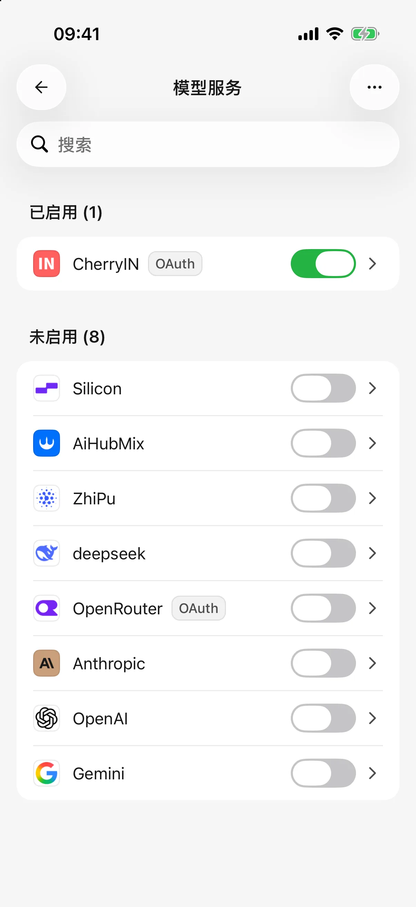
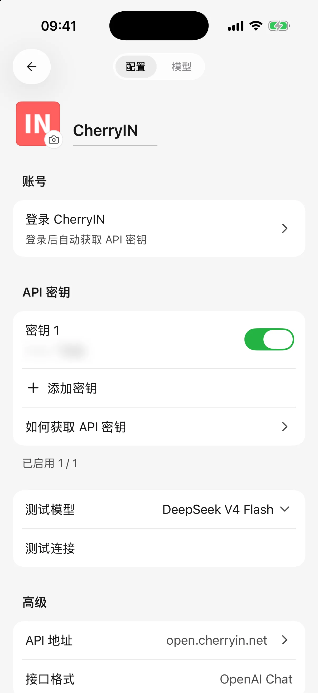
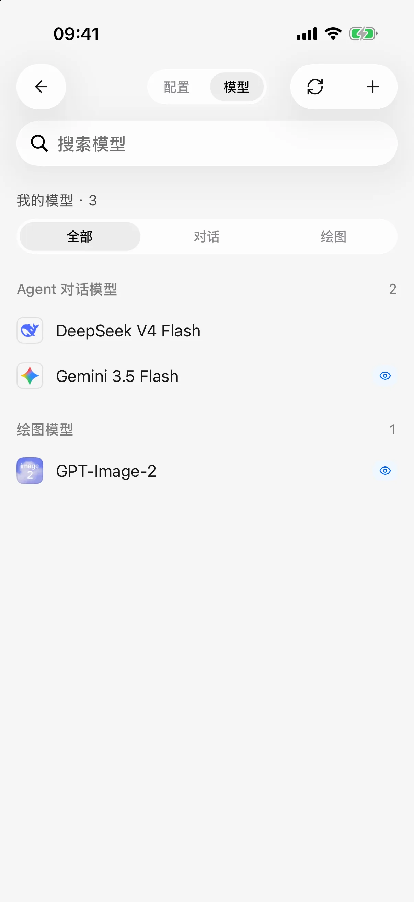

# 

 AI  AI **0.3.0** 

 **API Key**SuperAgent 

## 

1.  ** → **
2.  ****
3. 
4.  ID
5. 

<figure data-mobile-shot="phone"><figcaption>
<strong>iPhone</strong> · 
</figcaption></figure>
<figure data-mobile-shot="phone"><figcaption>
<strong>iPhone</strong> · 
</figcaption></figure>

## 

1.  ****
2. OpenAIAnthropicGemini 
3.  **Base URL**
4. 
5. 

### Base URL 

 `https://api.example.com/v1` `/chat/completions` 

 `#` `https://api.example.com#`

 HTTP `localhost`  `127.0.0.1` 

## 

**“”** 

* 
*  ****
* 
* 

## 

 SuperAgent 

## 

## 

 **** 

“”“”

 ** → ** 

<figure data-mobile-shot="phone"><figcaption>
<strong>iPhone</strong> · 
</figcaption></figure>

## 

* 
* 
* 
* 
