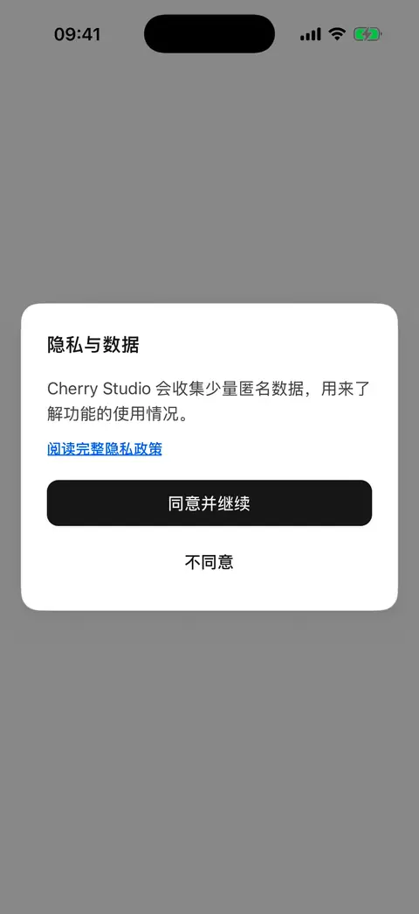
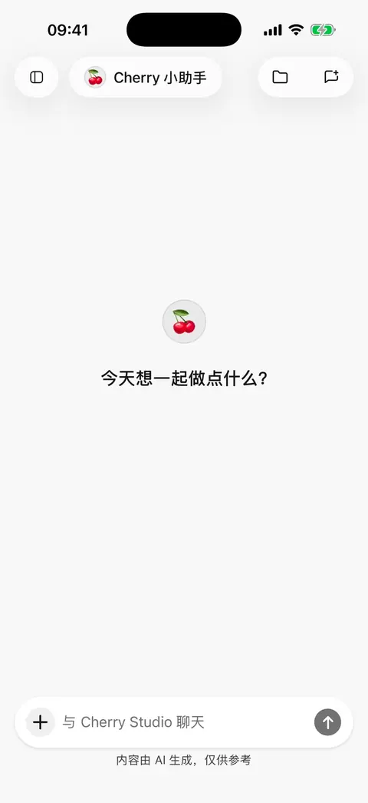

# 

## 1. 

* ** SuperAgent** 4 
* **** ** →  → ** 23 

<figure data-mobile-shot="phone"><figcaption>
<strong>iPhone </strong> · 
</figcaption></figure>

## 2. 

 **API Key**

 API Key

## 3. 

 ID 

## 4. 

 Cherry “”

“”

<figure data-mobile-shot="phone"><figcaption>
<strong>iPhone </strong> · 
</figcaption></figure>

## 

|  |  |
| --- | --- |
|  AI  |  |
|  |  |
|  |  |
|  |  |
|  |  |
| Notion  |  |
|  |  |
|  |  |
