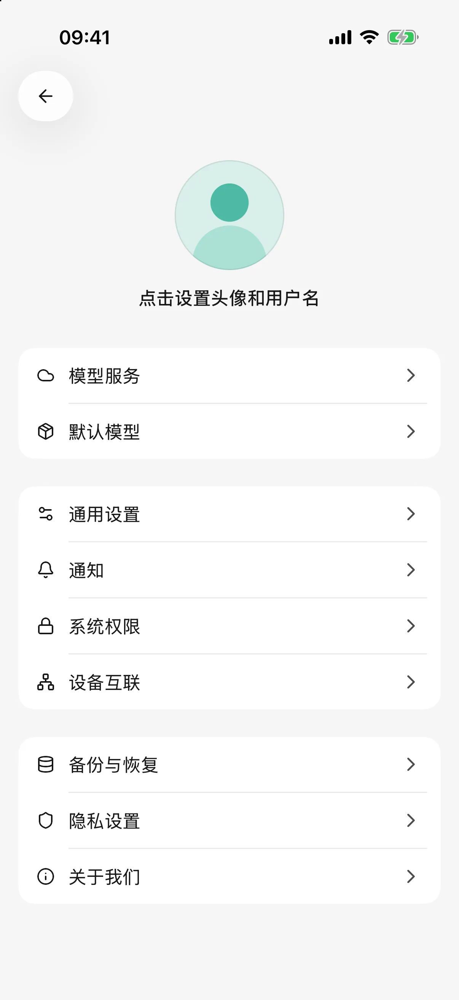
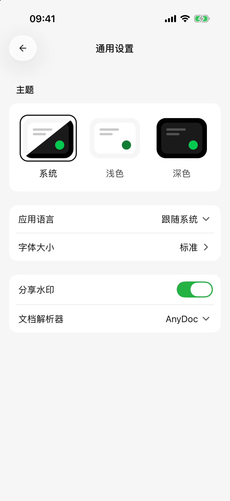
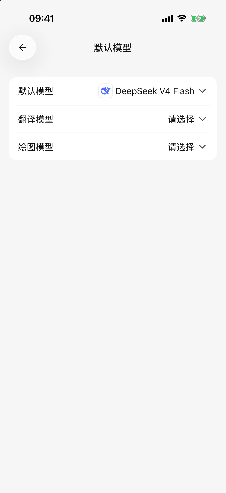
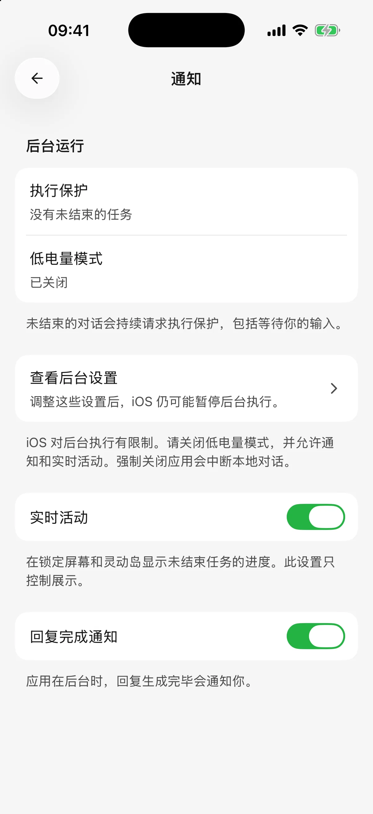

# 

## 

 ** → ** 

* 
* 
* 
* 

<figure data-mobile-shot="phone"><figcaption>
<strong>iPhone</strong> · 
</figcaption></figure>
<figure data-mobile-shot="phone"><figcaption>
<strong>iPhone</strong> · 
</figcaption></figure>

## 

 ** → ** 

* ****
* ****
* ****

<figure data-mobile-shot="phone"><figcaption>
<strong>iPhone</strong> · 
</figcaption></figure>

## 

 **AI **

**Token**

* 
* 
* 
* 

## 

 ** → **

|  |  |
| --- | --- |
| iPhone / iPad |  |
| Android |  |
|  |  |

 SuperAgent 

<figure data-mobile-shot="phone"><figcaption>
<strong>iPhone</strong> · 
</figcaption></figure>

## 

iOS 

## 

* ** →  → **
* ** → **
* ** → ** ID

## 

** → ** ** → ** 

