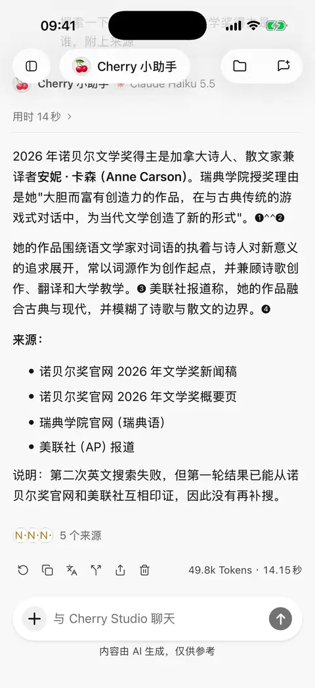
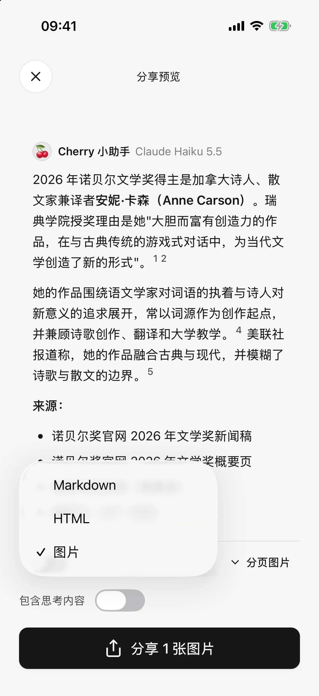

# 

## 

1. 
2. 
3. 
4. 
5. 

****

 128 

<figure data-mobile-shot="phone"><figcaption>
<strong>iPhone </strong> ·  →  → HTML  Markdown
</figcaption></figure>
<figure data-mobile-shot="phone"><figcaption>
<strong>iPhone</strong> · HTML  Markdown
</figcaption></figure>

## 

HTML  Markdown “”

## 

|  |  |  |
| --- | --- | --- |
| PNG |  |  |
| HTML |  |  |
| Markdown |  |  |

HTML  Markdown

 HTML 

## 

“ HTML  Markdown” HTML  Markdown

## 

 **** 

HTML 

## Markdown 

 PNGJPEG  Markdown  Markdown  HTML 

 GIFWebP 

## 

 HTMLHTML  Markdown

****

## 

 ** →  → **

## 

 ****MarkdownHTMLPDFDOCXXLSX  PPTX 

* 
* ****
* HTML 
* 

##  HTML 

 HTML  ****  ** PPT**

PPTX****

 SuperAgent 

## 

HTML [ PPT](html-export.md) PPT 
