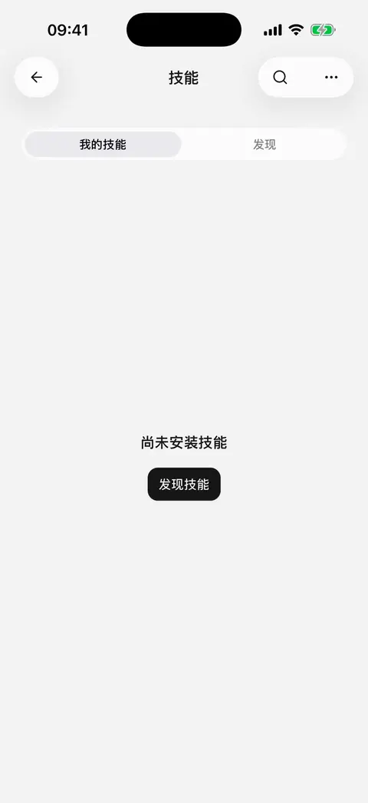
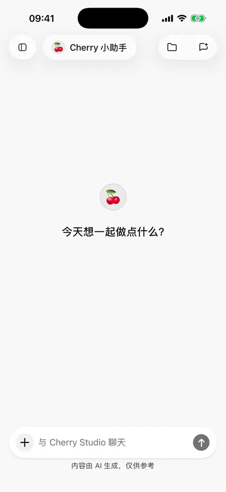

# 

Skills **0.3.0** 

## 

1.  **** ****
2. 
3.  ****
4. 

 CherryIN 

<figure data-mobile-shot="phone"><figcaption>
<strong>iPhone </strong> ·  →  →  → 
</figcaption></figure>

##  AI 

 **** skills.sh / GitHub 

> 

> []

## 

1.  **** 
2. 
3. 

********

<figure data-mobile-shot="phone"><figcaption>
<strong>iPhone </strong> · 
</figcaption></figure>
<figure data-mobile-shot="phone"><figcaption>
<strong>iPhone </strong> ·   →  
</figcaption></figure>

## 

> 

## 

*  **AI ** 
* 
* 
* 

## 

|  |  |
| --- | --- |
|  |  |
|  |  |
|  |  App  |
|  |  |
|  |  |

