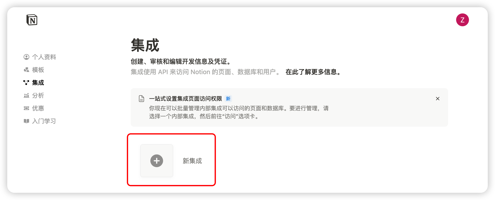
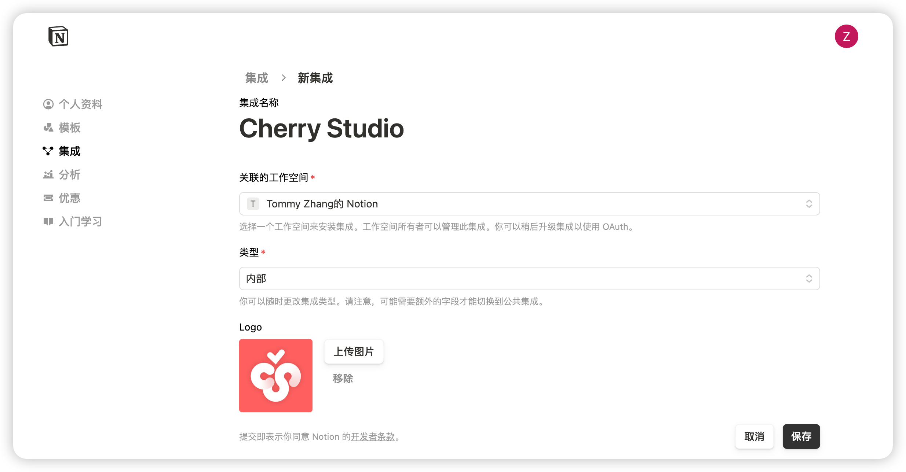
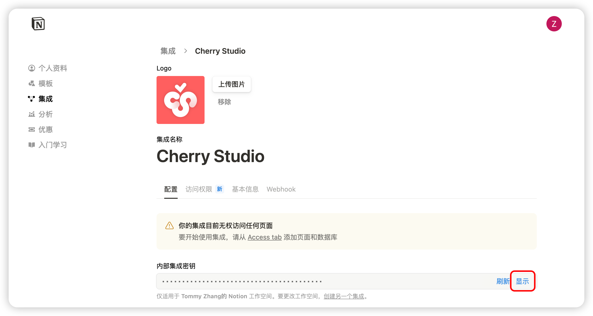
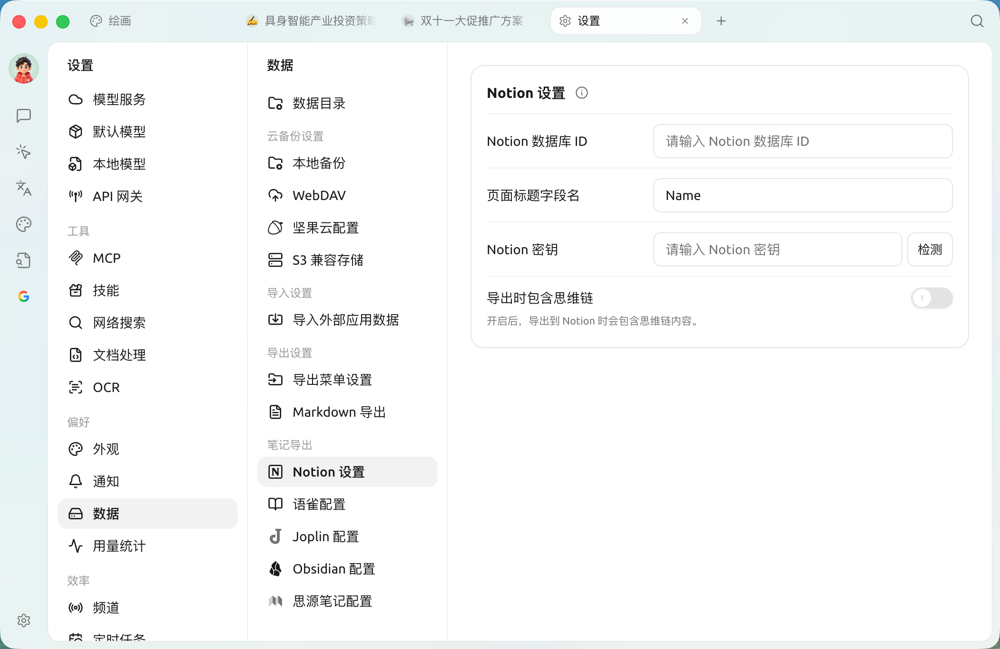
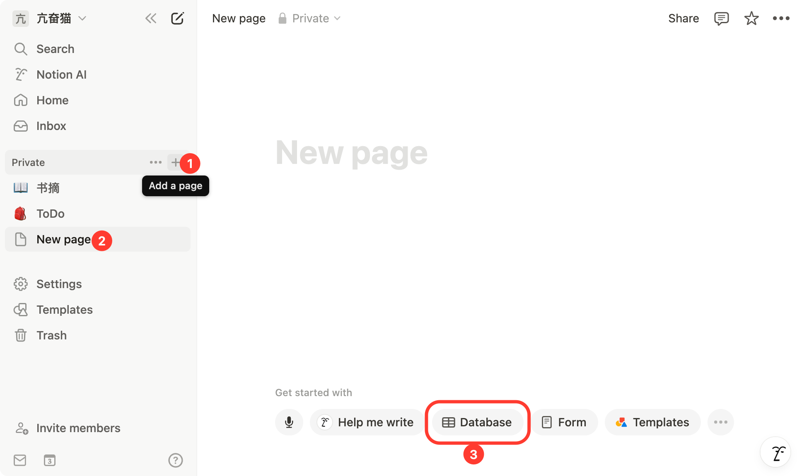
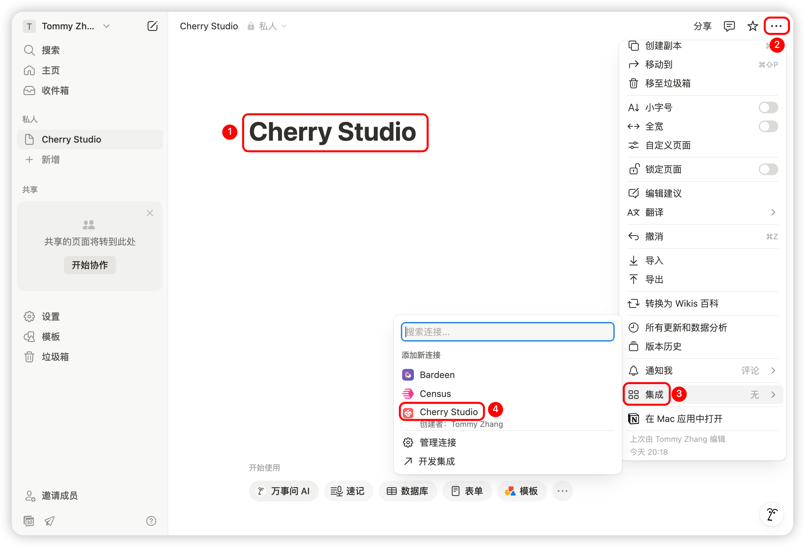
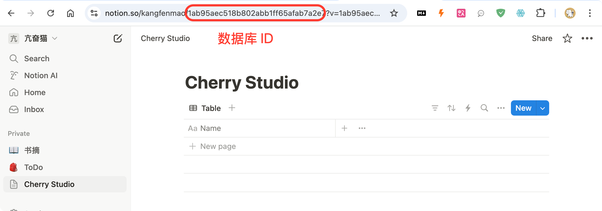
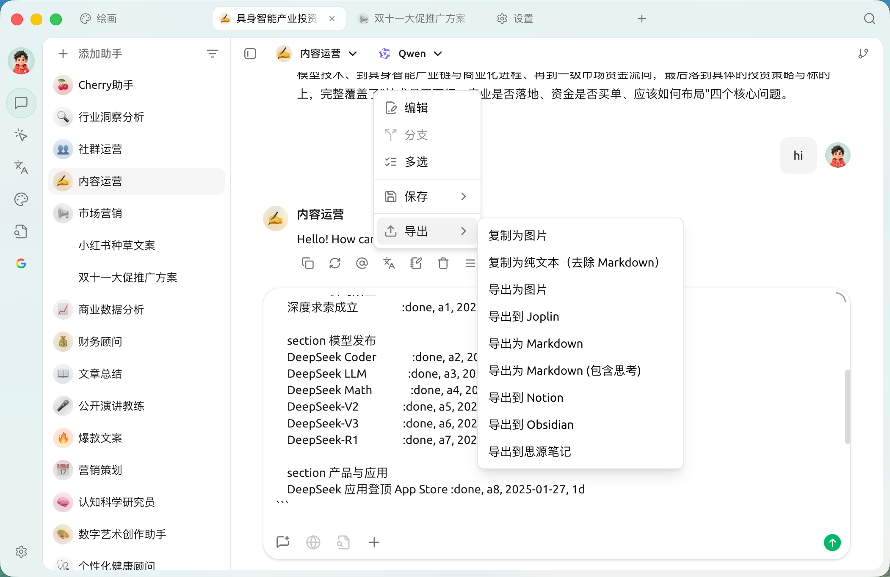
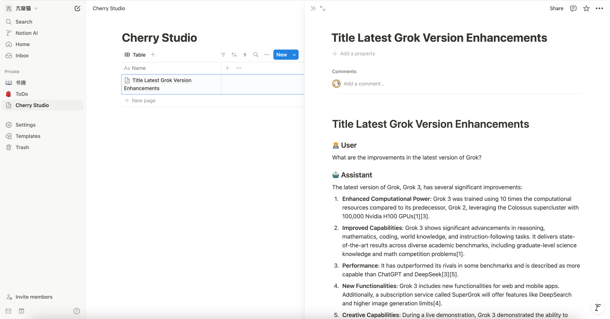

# Notion 

SuperAgent  Notion 

## 

 [Notion Integrations](https://www.notion.so/profile/integrations) 

<figure><figcaption>

</figcaption></figure>

## 

<figure><figcaption>

</figcaption></figure>

SuperAgent

<figure><figcaption></figcaption></figure>

## 

 SuperAgent 

<figure><figcaption>

</figcaption></figure>

<figure><figcaption>
→→Notion  /  ID / 
</figcaption></figure>

## 

 [Notion](https://www.notion.so/)  SuperAgent 

<figure><figcaption>

</figcaption></figure>

<figure><figcaption>
 APP
</figcaption></figure>

## 

<figure><figcaption>
 ID
</figcaption></figure>

 Notion  URL 

https://www.notion.so/\<long\_hash\_1>?v=\<long\_hash\_2>

 Notion  ID  `<long_hash_1>`  Notion 

## 

 ``

 `Name`\
 ``

## 

Notion  ✅  SuperAgent  Notion 

<figure><figcaption>
 Notion
</figcaption></figure>

<figure><figcaption>

</figcaption></figure>

***

### 

Bug   
