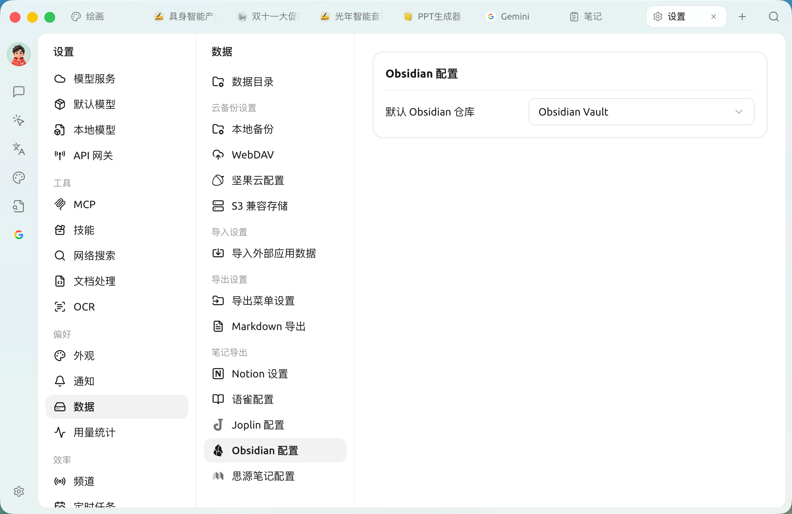
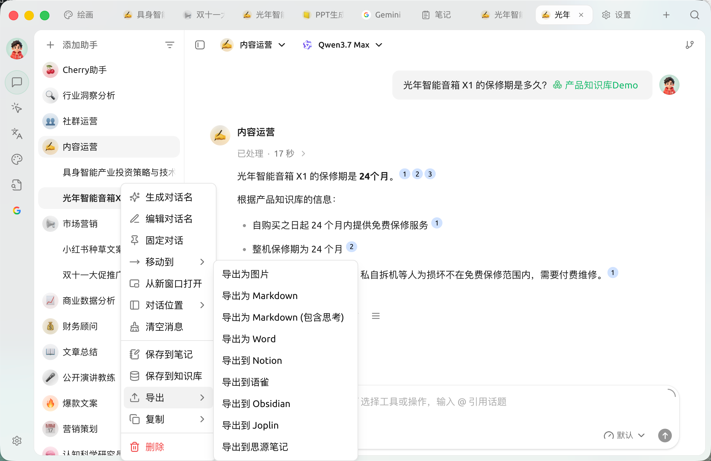
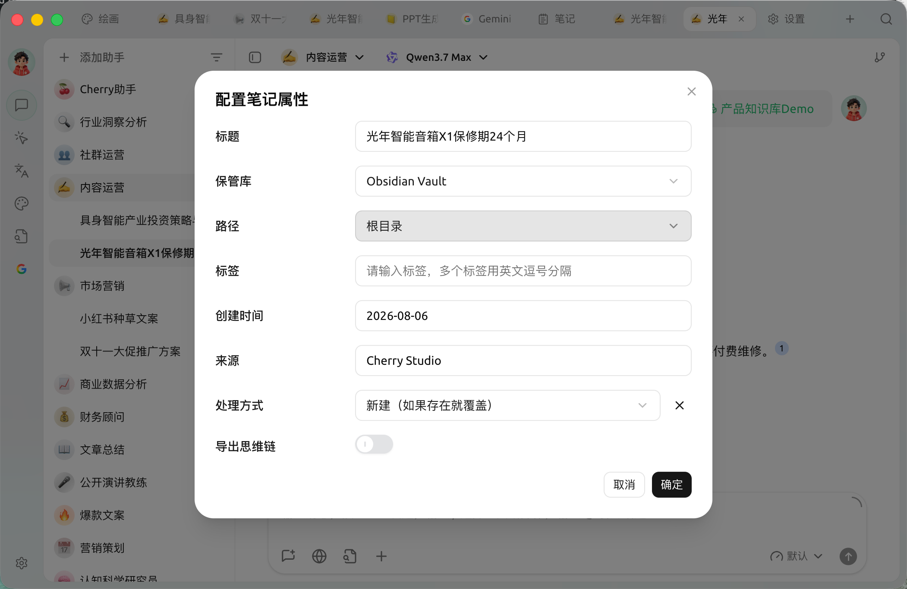
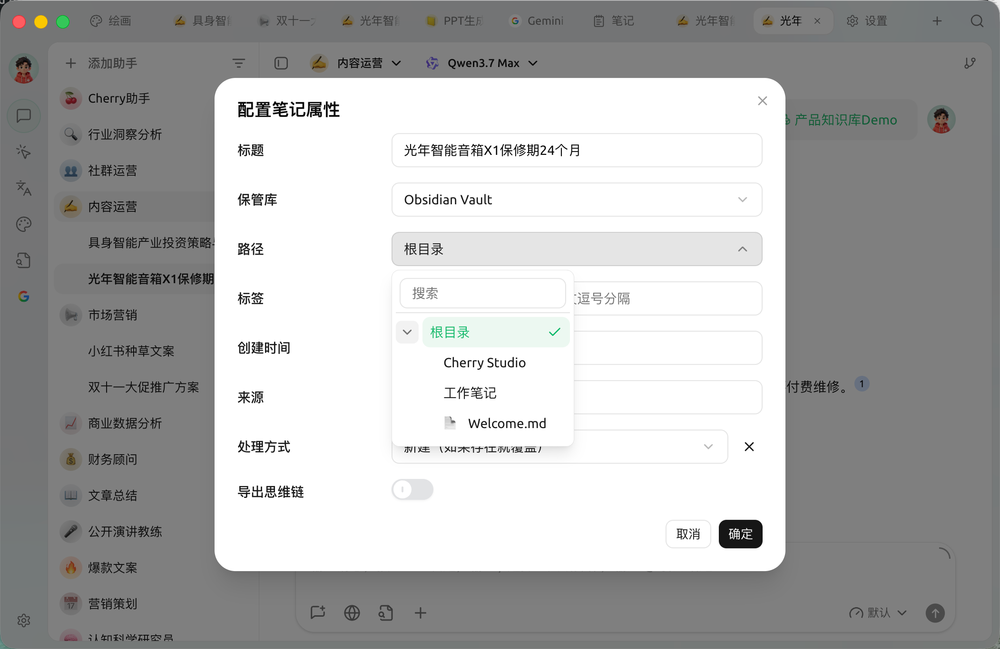
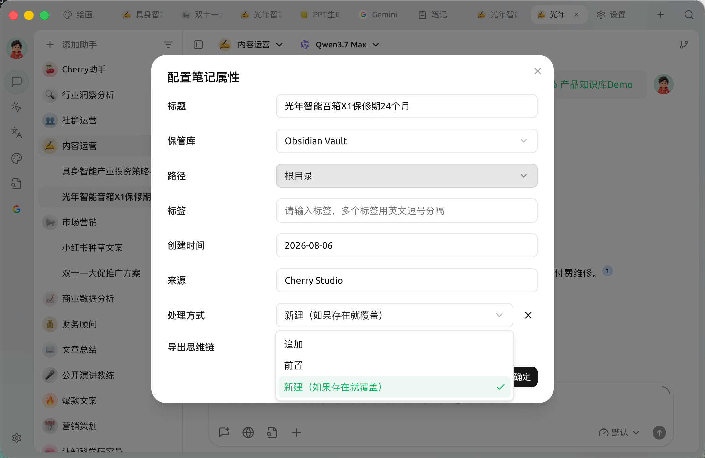
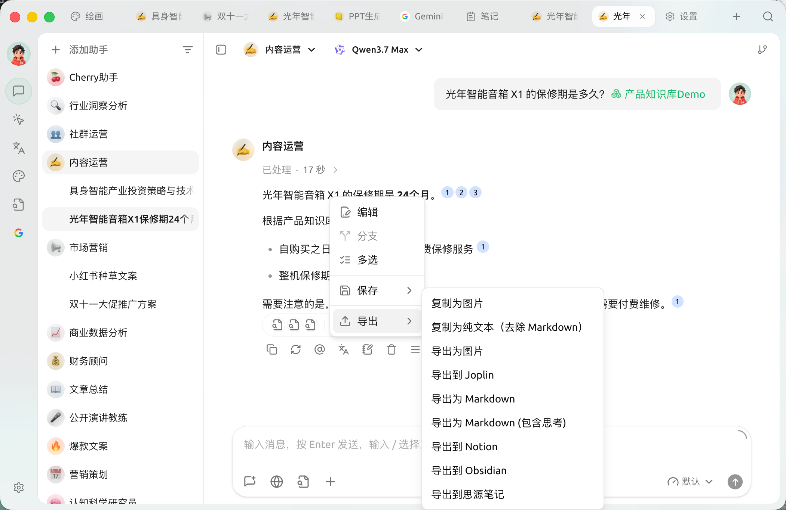
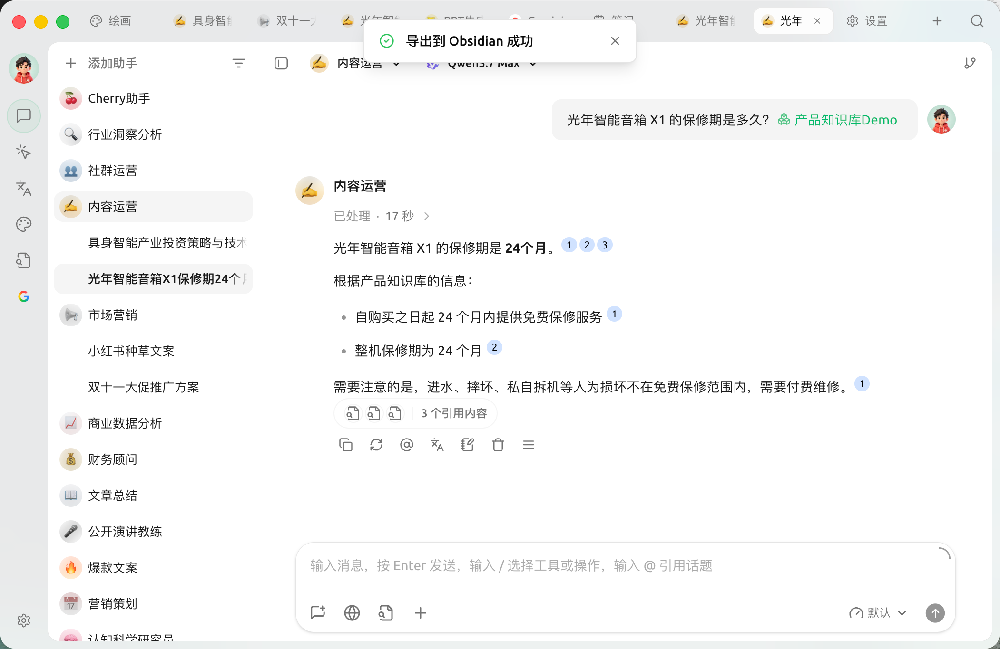
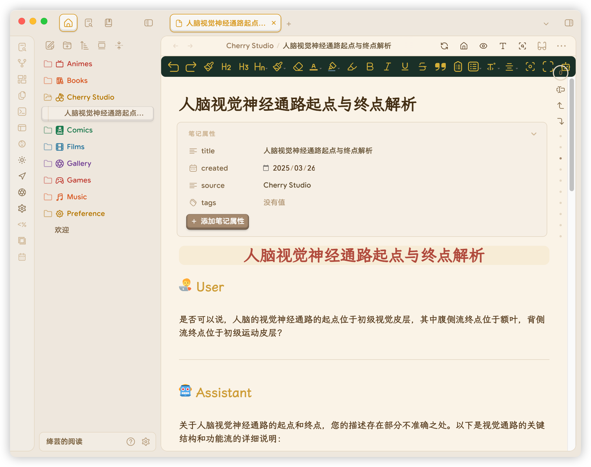
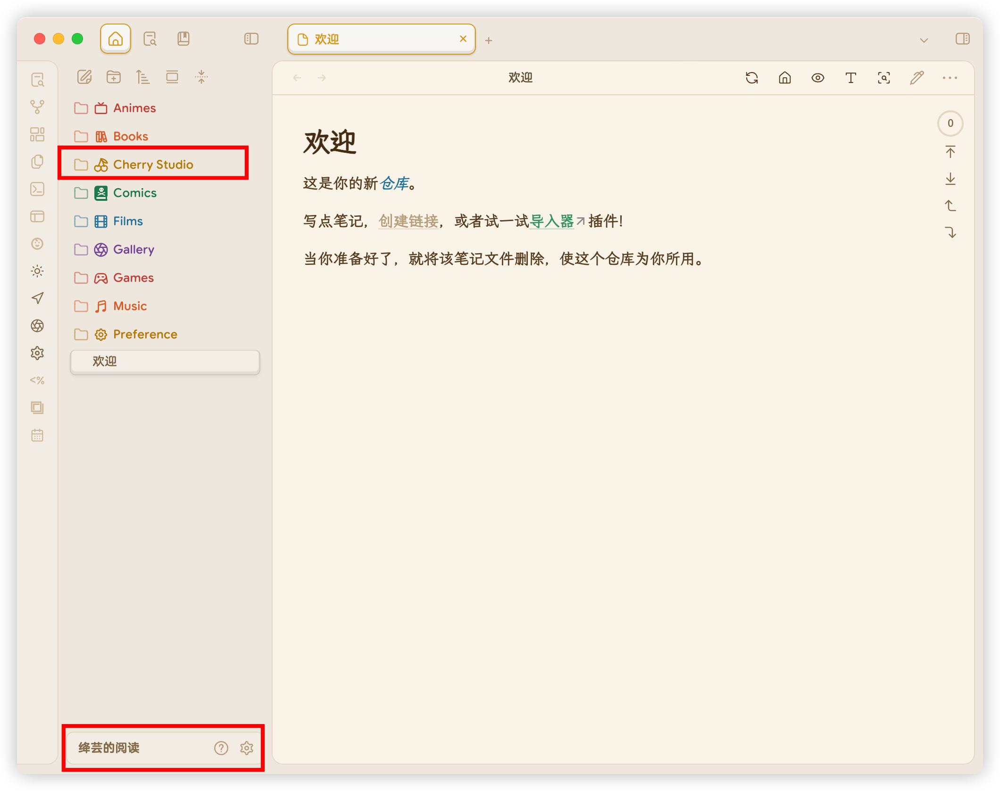
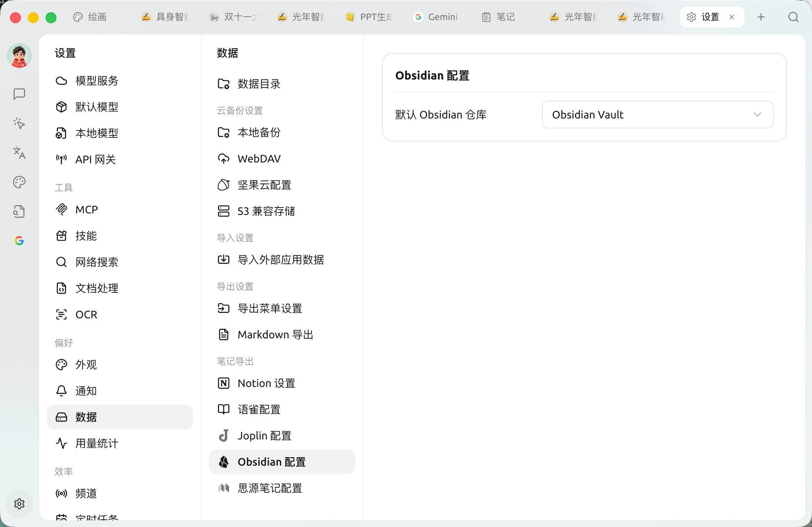

# Obsidian 

SuperAgent  Obsidian  Obsidian 


 Obsidian  SuperAgent  Obsidian  Obsidian Web Clipper  Obsidian  Obsidian  **1.7.2** 


## 


 Obsidian Obsidian 


###  SuperAgent

 SuperAgent &#x7684;_&#x8BBE;_ → __ → _Obsidian &#x7F6E;_&#x83DC; Obsidian  Obsidian 

<figure><figcaption></figcaption></figure>

### 

#### 

 SuperAgent &#x62E9;_&#x5BFC;_&#x51FB;_&#x5BFC; Obsidian_

<figure><figcaption></figcaption></figure>

 Obsidian  **Properties**&#x6240; Obsidian  ****  Obsidian  ****

* **** Obsidian 
* ****
*  Obsidian Properties
  * tags
  * created
  * source
*  Obsidian  **** 
*  Obsidian  **** 
  * **** ****  `` 
  * ****
  * ****


 Properties Properties


<figure><figcaption>

</figcaption></figure>

<figure><figcaption>

</figcaption></figure>

<figure><figcaption>

</figcaption></figure>

 Obsidian 

#### 

&#x7684;_&#x4E09;_&#x62E9;_&#x5BFC;_&#x51FB;_&#x5BFC; Obsidian_

<figure><figcaption>

</figcaption></figure>

 ****  ****  

### 

🎉  SuperAgent  Obsidian enjoy yourselves!

<figure><figcaption>
 Obsidian
</figcaption></figure>

<figure><figcaption>

</figcaption></figure>

***

##  SuperAgent\<v1.1.13

###  Obsidian

 Obsidian `` SuperAgent 

<figure><figcaption></figcaption></figure>

 `` 

###  SuperAgent

 SuperAgent →→Obsidian  ** Obsidian **SuperAgent  Obsidian 

<figure><figcaption>
→→Obsidian  Obsidian 
</figcaption></figure>


****" Obsidian " Obsidian 


### 

#### 

 SuperAgent &#x62E9;_&#x5BFC;_&#x51FB;_&#x5BFC; Obsidian_

 Obsidian  **Properties** Obsidian  **** Obsidian  **** 

* ****   `` 
* ****
* ****

<figure><figcaption>

</figcaption></figure>


 Properties Properties


#### 

&#x7684;_&#x4E09;_&#x62E9;_&#x5BFC;_&#x51FB;_&#x5BFC; Obsidian_

<figure><figcaption>

</figcaption></figure>

 ****  ****  

### 

🎉  SuperAgent  Obsidian enjoy yourselves!

<figure><figcaption>
 Obsidian
</figcaption></figure>

<figure><figcaption>

</figcaption></figure>

***

### 

Bug   
