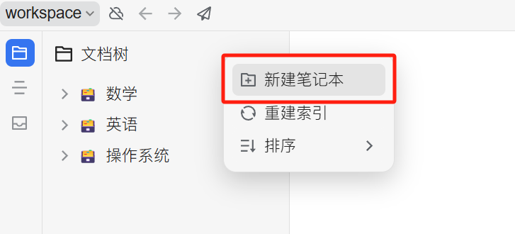
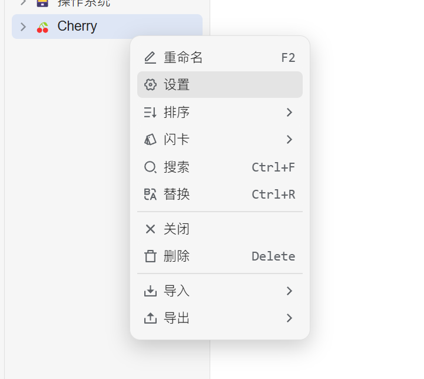
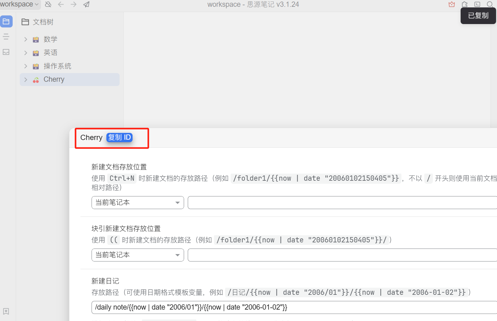
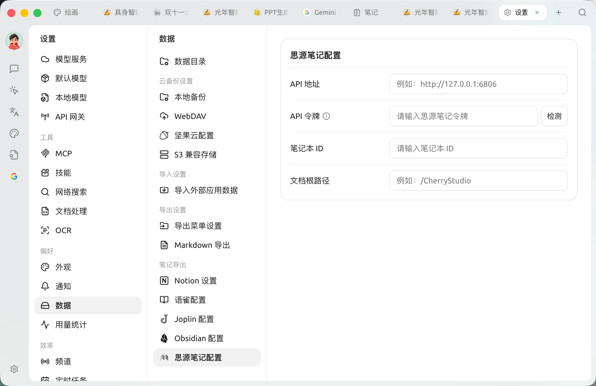
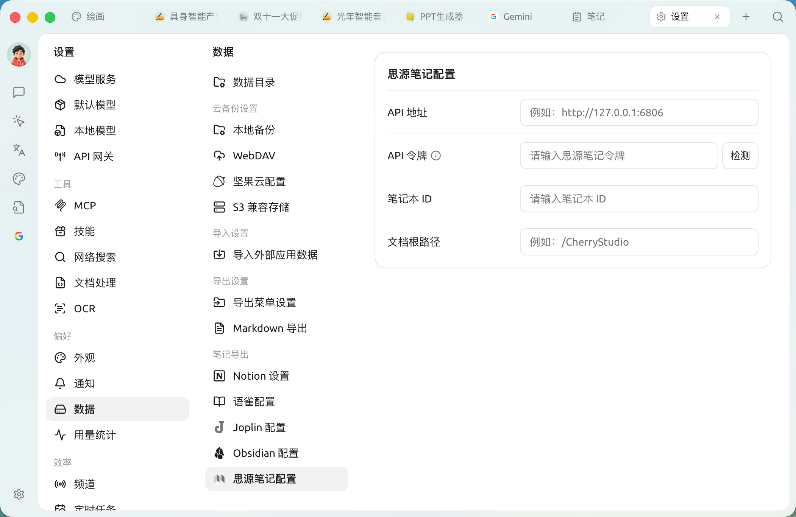
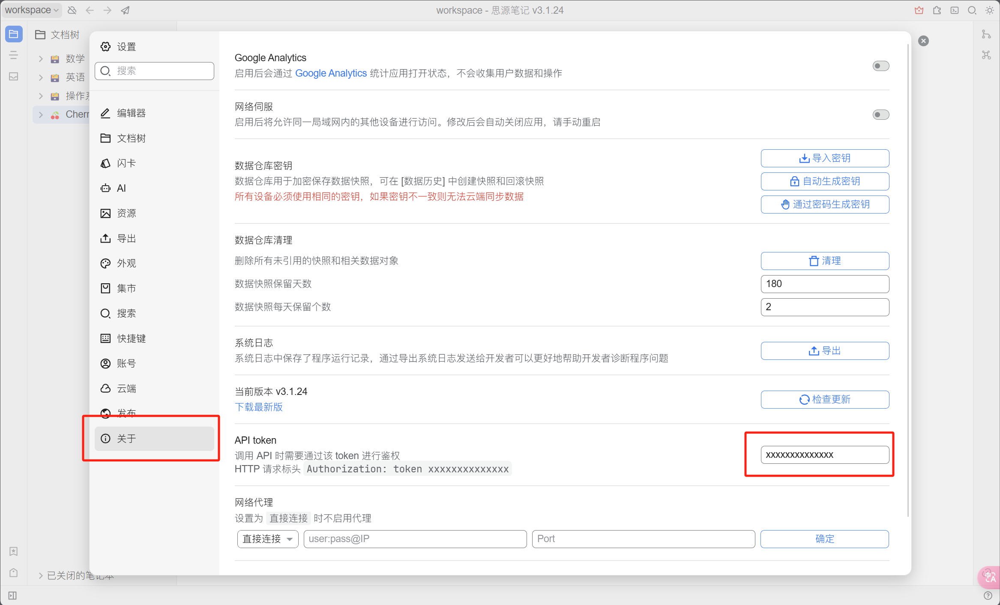
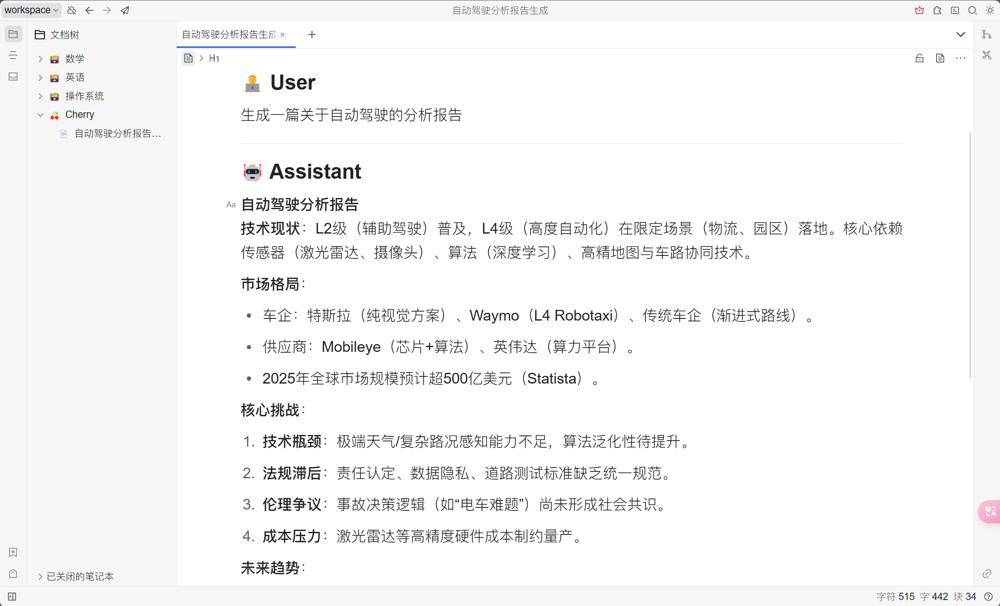

# 

## 

<figure><figcaption>

</figcaption></figure>

## 

 `ID`

<figure><figcaption>

</figcaption></figure>

<figure><figcaption>
 ID 
</figcaption></figure>

## 

 ID  SuperAgent 

<figure><figcaption>
 ID 
</figcaption></figure>

## 

* ****\
   `http://127.0.0.1:6806`
* ****\
   `http://note.domain.com`

<figure><figcaption>

</figcaption></figure>

## 

 `API Token`

<figure><figcaption>

</figcaption></figure>

 SuperAgent 

## 

 ✅  SuperAgent 

<figure><figcaption>

</figcaption></figure>

***

### 

Bug   
