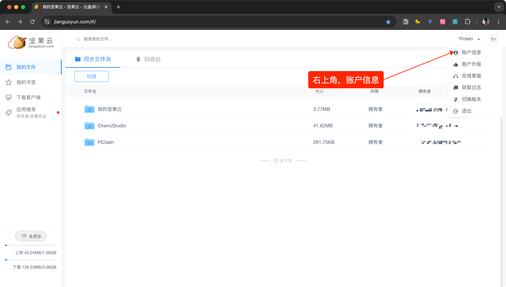
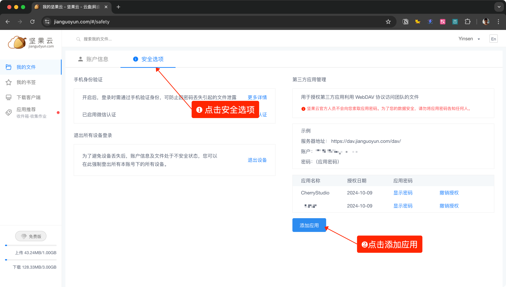
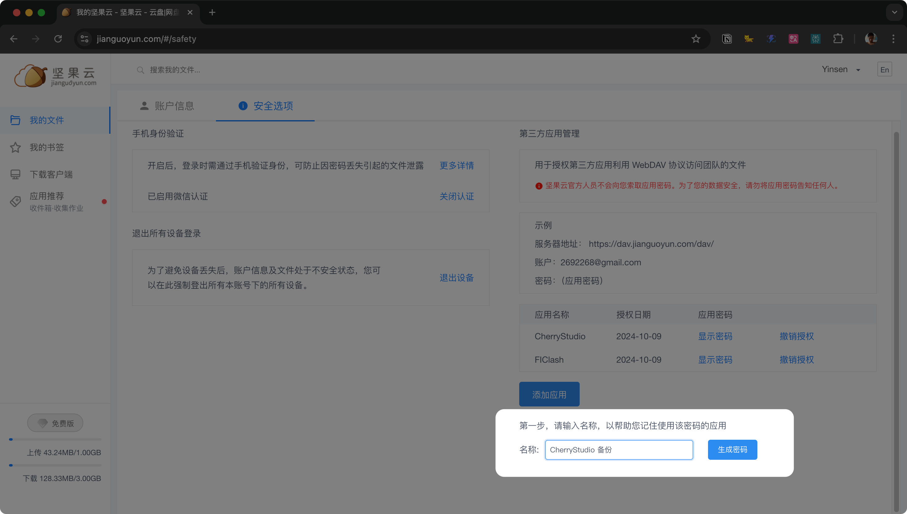
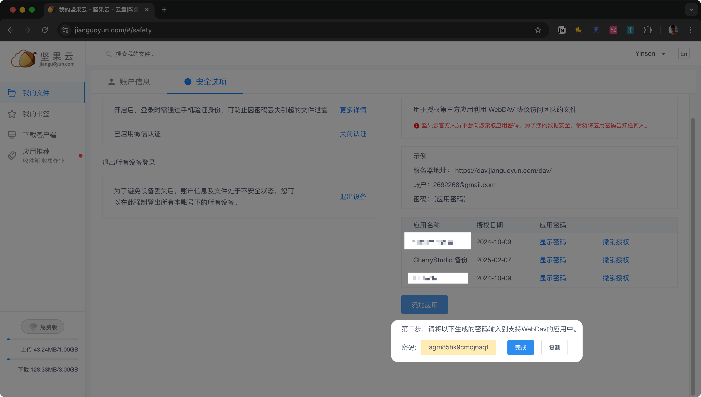
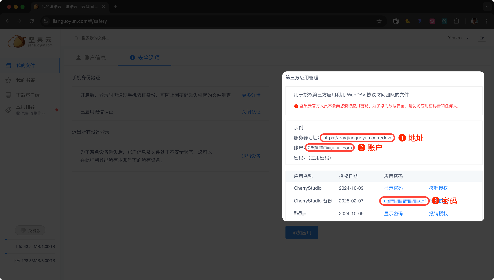
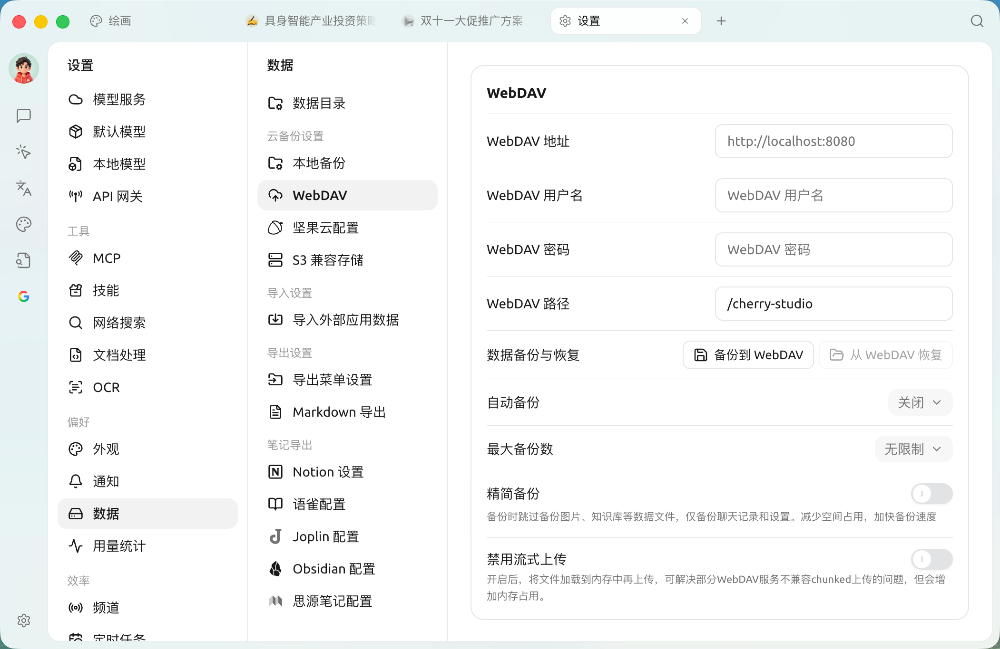

# WebDAV 

SuperAgent  WebDAV  WebDAV 

 WebDAV  `A`  →→  `WebDAV`  →→  `B` 

#### 

1. “”

<figure><figcaption></figcaption></figure>

2. “”“”

<figure><figcaption></figcaption></figure>

3. 

<figure><figcaption></figcaption></figure>

4. 

<figure><figcaption></figcaption></figure>

5. 

<figure><figcaption></figcaption></figure>

6.  SuperAgent→ WebDAV 

<figure><figcaption></figcaption></figure>

7.  WebDAV WebDAV 


WebDAV 

* 
* [123 ](https://www.123pan.com/)
* 
* [Box](https://www.box.com/) ( 10GB 250MB)
* [Dropbox](https://www.dropbox.com/) Dropbox  2GB 16GB 
* [TeraCloud](https://teracloud.jp/en/)  10GB 5GB 
* [Yandex Disk](https://disk.yandex.com/) ( 10GB )

* [Alist](https://alist.nn.ci/zh/)
* [Cloudreve](https://cloudreve.org/)
* [sharelist](https://github.com/reruin/sharelist)


***

### 

Bug   
