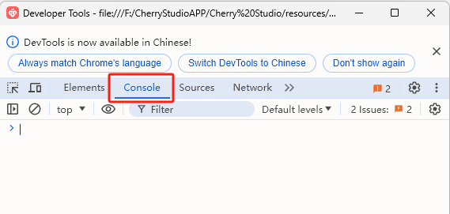

#  CSS 


 css css  css 


*  SuperAgent <kbd>Ctrl</kbd>+<kbd>Shift</kbd>+<kbd>I</kbd>MacOS<kbd>command</kbd>+<kbd>option</kbd>+<kbd>I</kbd>
*  `Console`

<figure><figcaption></figcaption></figure>

*  `document.getElementById('user-defined-custom-css').remove()` 
*  css  SuperAgent  css 

***

### 💡 

Bug   
