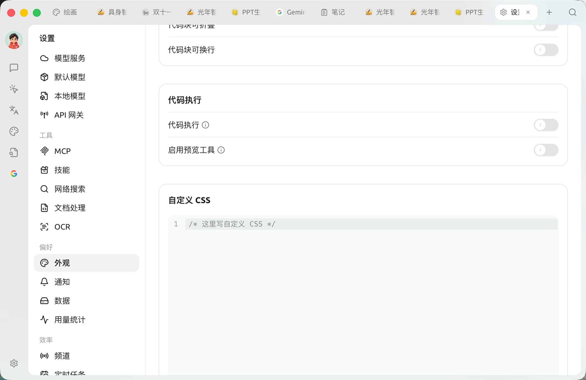

#  CSS

 CSS

### 

 **→** ** CSS** 

<figure><figcaption><p>→ CSS</p></figcaption></figure>

 CSS  `<head>`  `<style id="user-defined-custom-css">` cascade layer `!important` 

### 


```css
/* 1.  */
body {
  font-family: "", sans-serif;
}

/* 2.  /  */
:root {
  --primary: #1a8f5a;
  --chat-user: rgba(26, 143, 90, 0.08);
}

/* 3. ( .dark ) */
.dark {
  --primary: #28b561;
  --chat-user: rgba(40, 181, 97, 0.12);
}

/* 4.  */
#content-container {
  background-color: #f6f4ec;
}
```

### 

 CSS () `:root`  `.dark` —— `.dark` / `:root`  `.dark`  `theme-mode` 


|  |  |
| --- | --- |
| `--background` / `--foreground` |  / () |
| `--primary` / `--primary-foreground` |  /  |
| `--card` / `--popover` |  |
| `--muted` / `--muted-foreground` |  /  |
| `--border` / `--input` / `--ring` |  |
| `--sidebar`  |  |
| `--chat-user` |  |
| `--link` |  |
| `--code-block` / `--inline-code` |  /  |
| `--font-family` / `--code-font-family` |  /  |
| `--radius` |  |


- [https://github.com/DrOlu/SuperAgent/tree/main/src/renderer/assets/styles](https://github.com/DrOlu/SuperAgent/tree/main/src/renderer/assets/styles)
- ()[https://github.com/DrOlu/SuperAgent/tree/main/packages/ui/src/styles](https://github.com/DrOlu/SuperAgent/tree/main/packages/ui/src/styles)

### 

 CSS 

### 

SuperAgent : [https://github.com/boilcy/cherrycss](https://github.com/boilcy/cherrycss)

 SuperAgent : [https://linux.do/t/topic/325119/129](https://linux.do/t/topic/325119/129)

***

### 💡 

Bug  [](../../question-contact/suggestions.md) 
