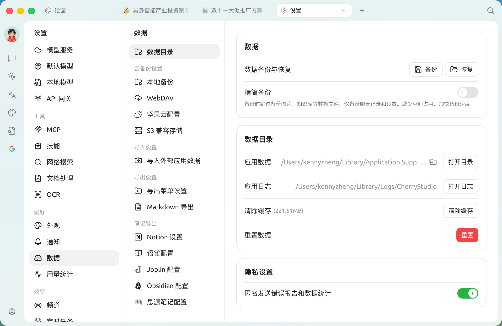

## 

SuperAgent 

* **macOS**`~/Library/Application Support/SuperAgent`
* **Windows**`%APPDATA%\SuperAgent` `C:\Users\<>\AppData\Roaming\SuperAgent`
* **Linux**`~/.config/SuperAgent`

<figure><figcaption></figcaption></figure>

## 

 C  /  SuperAgent  ** / **

>  ****  ****[WebDAV](../data-settings/webdav.md) / [S3](../data-settings/s3-compatible.md) 

* ****→→→

***

### 💡 

Bug   
