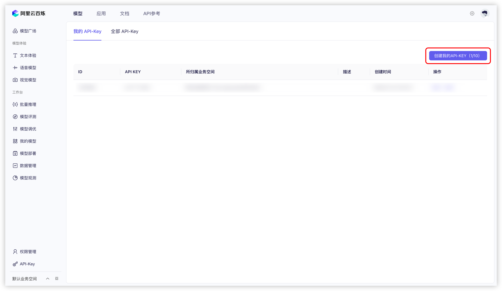
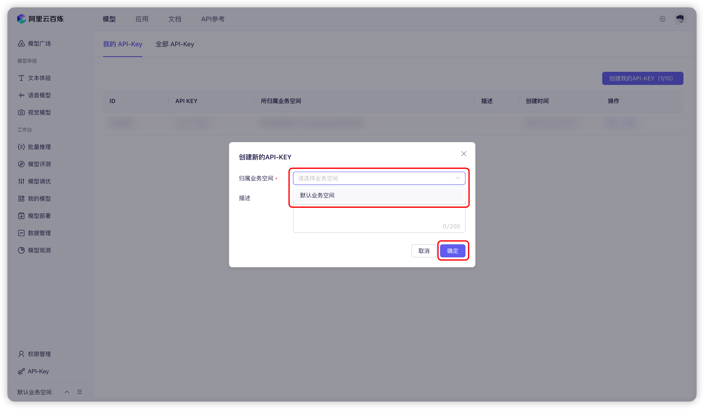
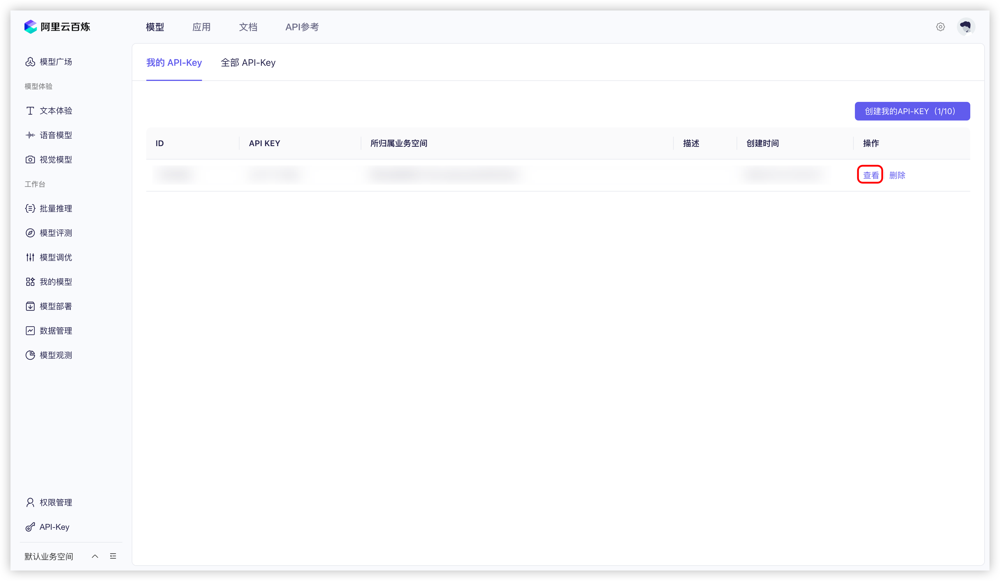
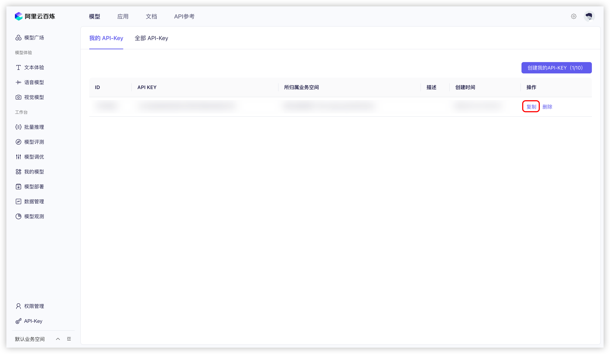
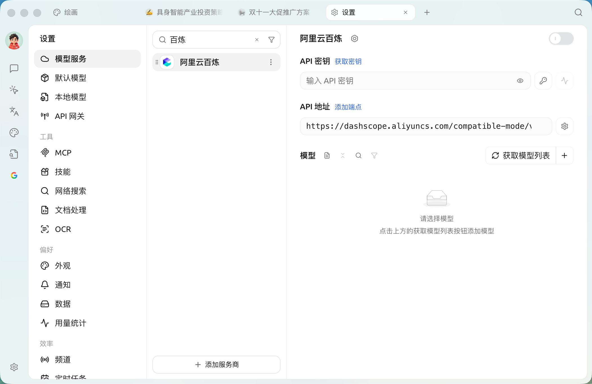

# 

1.  
2.  ` API-KEY` 

<figure><figcaption>
 API 
</figcaption></figure>

3. 

<figure><figcaption>
 API 
</figcaption></figure>

4.  `` 
5.  `` 

    <figure><figcaption>
 API 
</figcaption></figure>
6.  `` 

    <figure><figcaption>
 API 
</figcaption></figure>
7.  SuperAgent `` → `` → ``  `API `  API 

    <figure><figcaption>
 API 
</figcaption></figure>
8.   

## 

 Qwen  URL  🌐 

 🌐 →SuperAgent  


  


***

### 

Bug   
