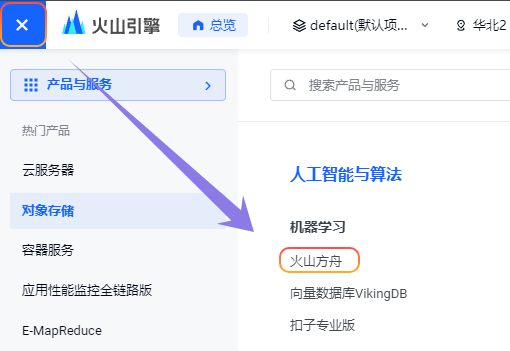
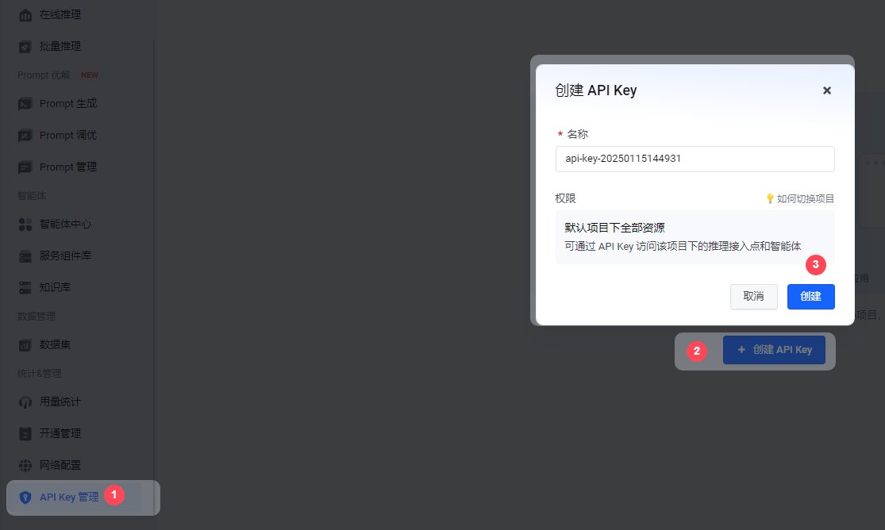
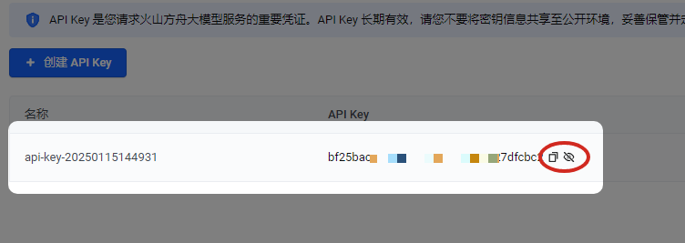
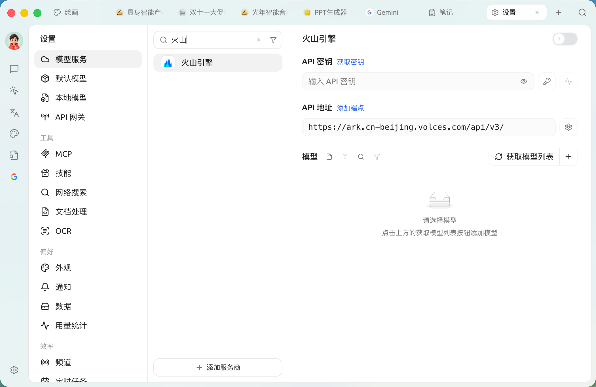
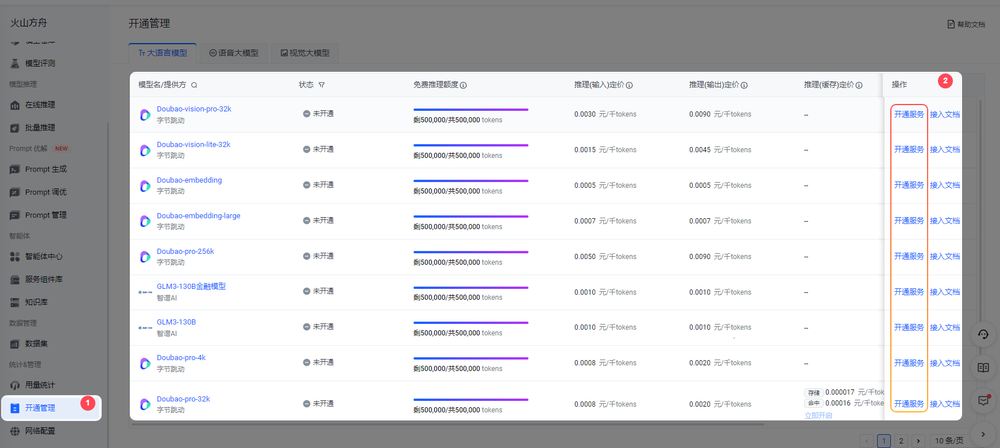
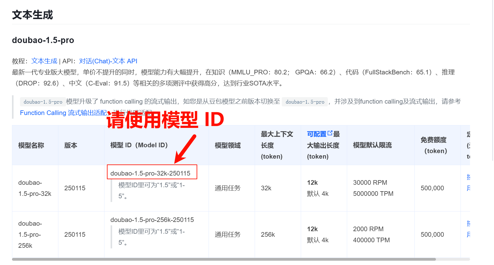
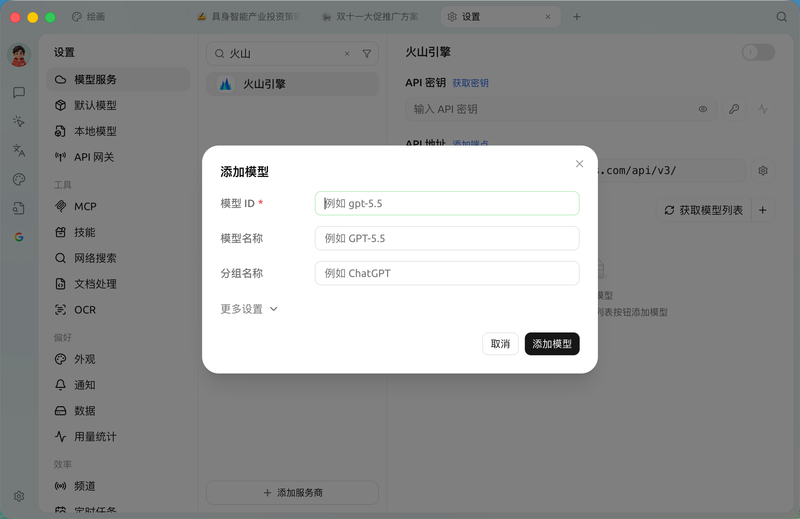
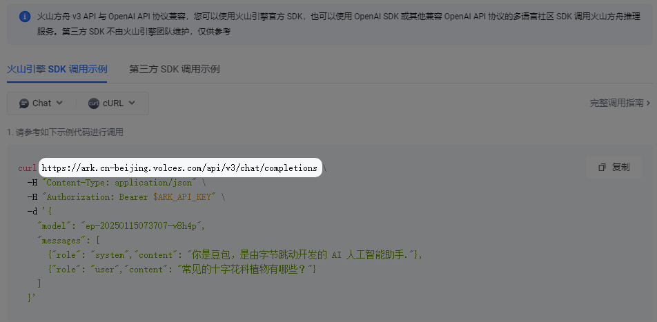

# 

*  
*  

<figure><figcaption></figcaption></figure>

###  API Key

*  [API Key ](https://console.volcengine.com/ark/region:ark+cn-beijing/apiKey)
*  API Key

<figure><figcaption></figcaption></figure>

*  API Key 

<figure><figcaption></figcaption></figure>

*  API Key  SuperAgent 

<figure><figcaption></figcaption></figure>

### 

*    DeepSeek 

<figure><figcaption></figcaption></figure>

*     ID

<figure><figcaption></figcaption></figure>

*  SuperAgent   
*   ID   ID 

<figure><figcaption></figcaption></figure>

* 

### API 

API 

* `https://ark.cn-beijing.volces.com/api/v3/`
* `https://ark.cn-beijing.volces.com/api/v3/chat/completions#`



 `/`  `#`  API 


<figure><figcaption>
 cURL 
</figcaption></figure>

***

### 

Bug   
