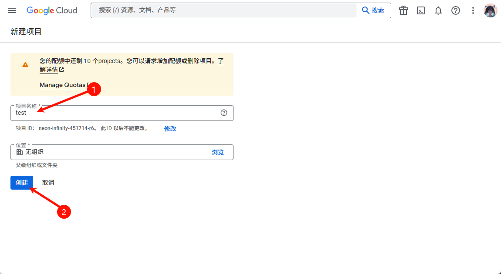
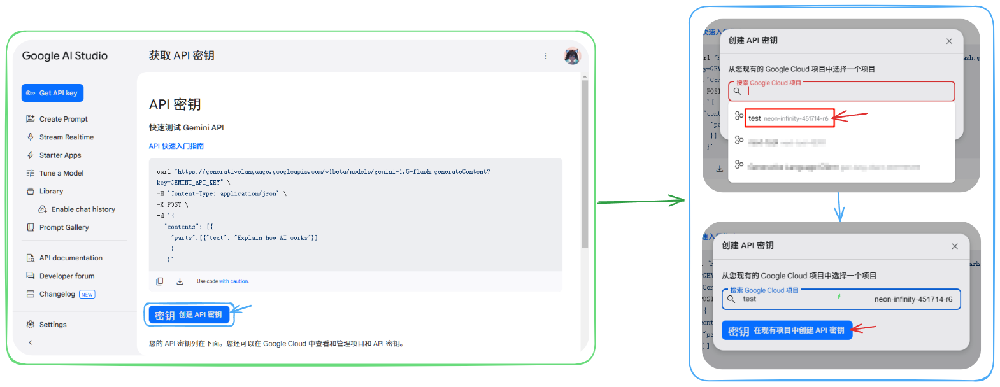
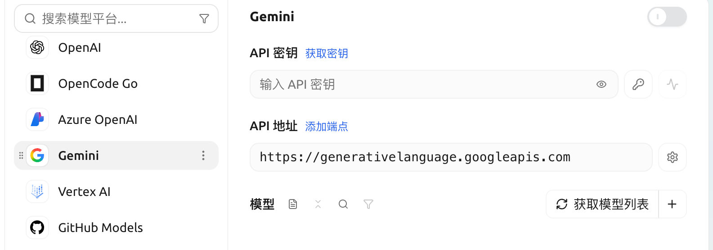

# Google Gemini

##  APIKey

*  Gemini  api key  Google Cloud 
*  [Google Cloud](https://console.cloud.google.com/projectcreate) 

<figure><figcaption></figcaption></figure>

*  [API Key ](https://aistudio.google.com/app/apikey?hl=zh-cn)  ` API`

<figure><figcaption></figcaption></figure>

*  key  SuperAgent  
*  Gemini key

<figure><figcaption></figcaption></figure>

* 


-  Google Gemini 


***

### 

Bug   
