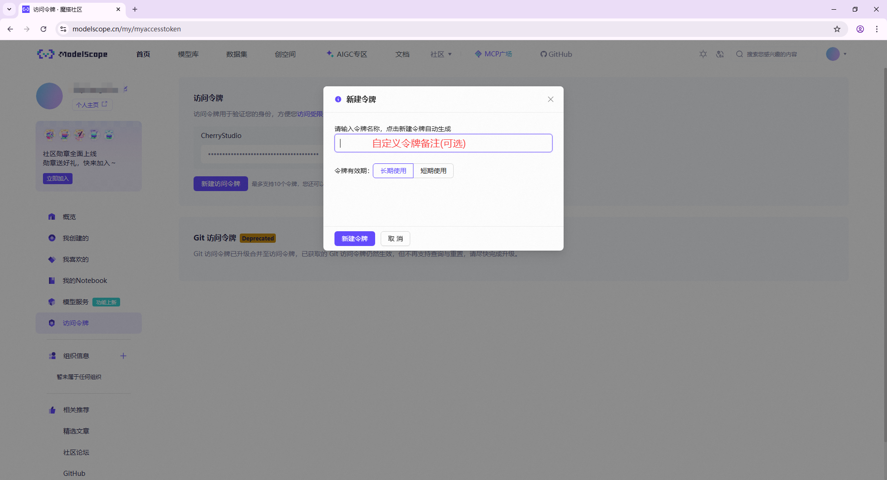
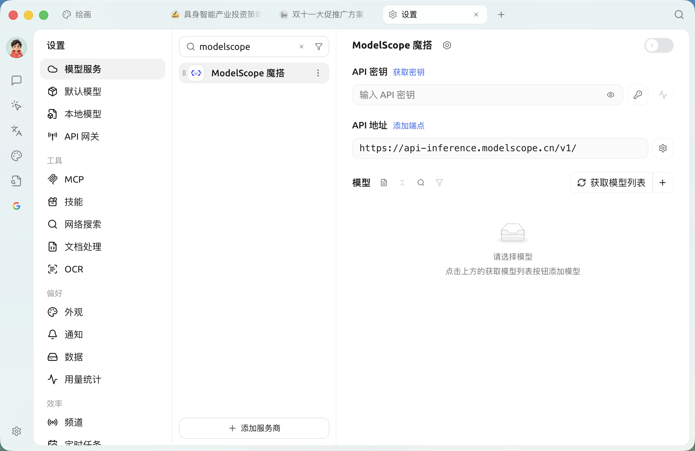
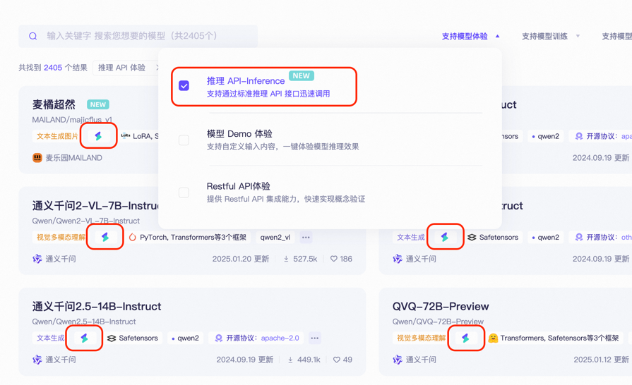
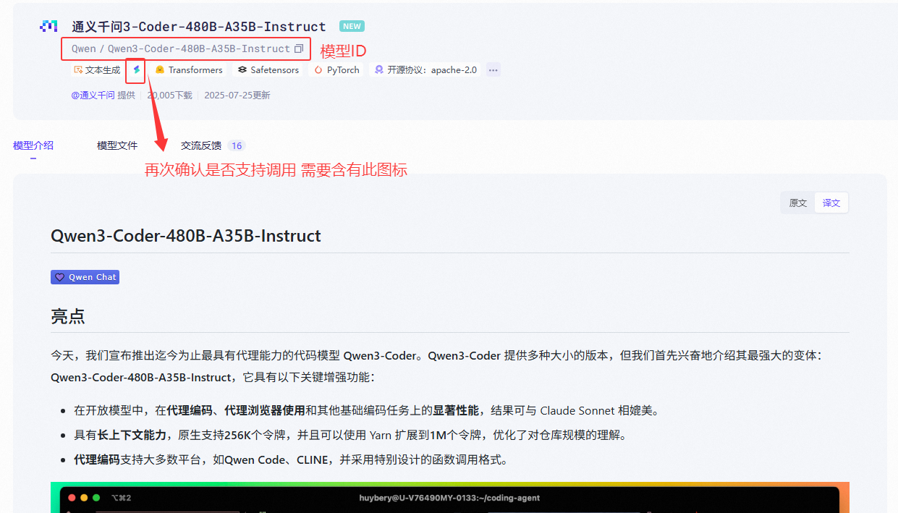
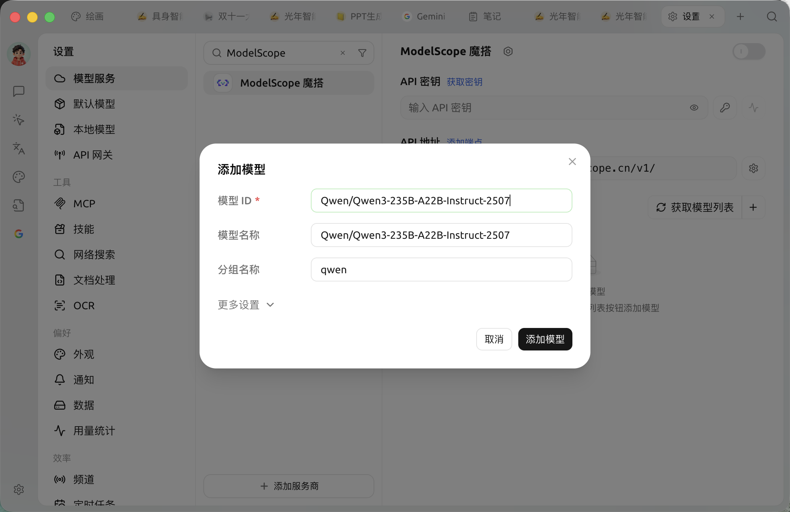
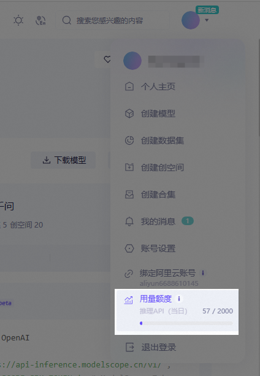

# ModelScope

##  ModelScope

> ModelScope MaaS AI  **** 
>
>  **API-Inference ** API  AI 

### 

* ✅ **** **2000  API **
* ✅ **** NLPCV 1000+ 
* ✅ **** RESTful API 

***

## SuperAgent 

###  1 ModelScope API 

1. ****
   *  [ModelScope ](https://modelscope.cn) →  **** →  
2. ****

    *  [** → **](https://modelscope.cn/my/myaccesstoken)
    *  **``** →  → ****__ 

    > 🔑 ****

###  2 SuperAgent

*  **SuperAgent** → ** →  → ModelScope**
*  `API `  
*  **``** 

###  3 API

1. ** API **

    *  [ModelScope ](https://modelscope.cn/models)
    * ** `API-Inference`** `API`  

    > API-Inference 
2. ** ID**
   *  →  **Model ID** `damo/nlp_structbert_sentiment-classification_chinese-base` 
3. ** SuperAgent**
   *  ` ID`  ID →  →  

***

## 

### 

* 🎫 **** ** 2000  API **\*
* 🔁 **** UTC+8 00:00 ****
* 💡 ****
  *  API  `429 `
  *  /  / 

### 

*  ModelScope →  **``** → **`API `** 

> ⚠️  API-Inference  2000 

***

### 

Bug   
