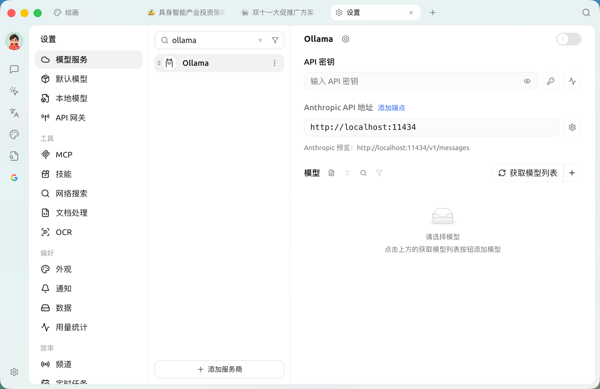

# Ollama

Ollama LLMsSuperAgent  Ollama  LLM 

##  Ollama

Ollama LLM

* **** 
* ****  LLM
* ****  Llama 2DeepseekMistralGemma 
* ****  macOSWindows  Linux 
* ** API** OpenAI 

##  SuperAgent  Ollama

* ****  API  LLM 
* **** 
* ****  LLM 
* ****  LLM

##  SuperAgent  Ollama

### **1.  Ollama**

 Ollama

* ** Ollama**  Ollama [https://ollama.com/](https://ollama.com/)\
     Linux  ollama

    ```sh
    curl -fsSL https://ollama.com/install.sh | sh
    ```
* ** Ollama** 
* ****  `ollama run`  Llama 2 

    ```sh
    ollama run llama3.2
    ```

    Ollama 
* ** Ollama **  SuperAgent  Ollama  Ollama 

### **2.  SuperAgent  Ollama **

 SuperAgent  Ollama  AI 

* ****  SuperAgent “”
* **** “”
* ****  Ollama

<figure><figcaption></figcaption></figure>

### **3.  Ollama **

 Ollama

1. ****
   *  Ollama 
2. **API **
   * Ollama  **** API 
3. **API **
   *  Ollama  API 

       ```
       http://localhost:11434/
       ```

       
4. **** SuperAgent  Ollama 
5. ****
   * “+ ” Ollama 
   *  `ollama run llama3.2`  `llama3.2` ,  `llama3.2`
   * “”

## 

 SuperAgent  Ollama  LLM 

## 

* **** Ollama 
* ****  `ollama list`  Ollama 
* **** CPUGPU
* **Ollama **:  `Ollama`  Ollama 

***

### 

Bug  [](../../question-contact/suggestions.md) 
