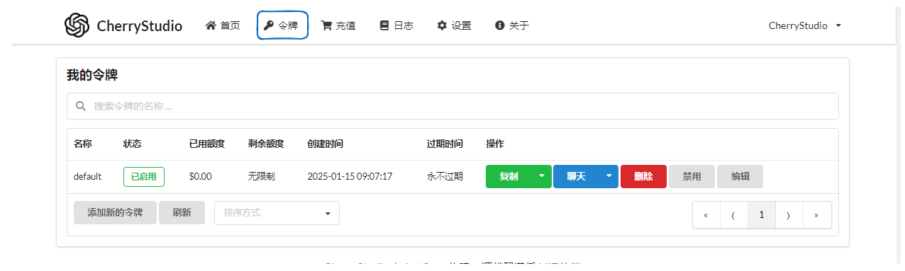
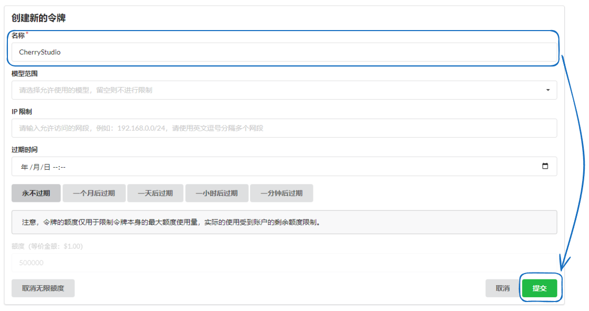
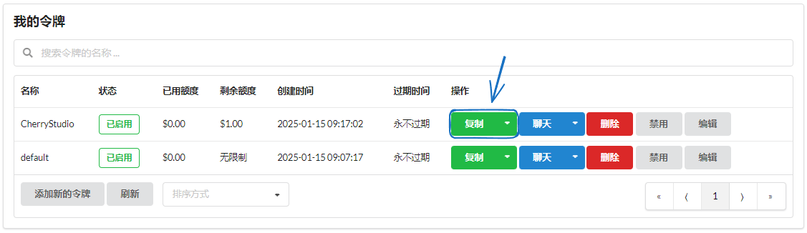
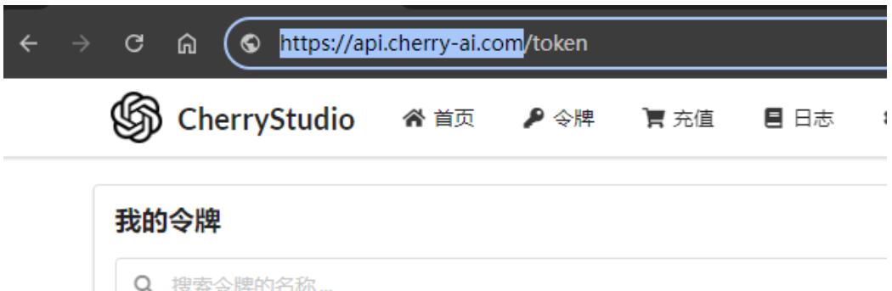

# OneAPI

* 

<figure><figcaption></figcaption></figure>

*  default ↑

<figure><figcaption></figcaption></figure>

* 

<figure><figcaption></figcaption></figure>

*  SuperAgent  ``
*  OpenAI

*  key
*  API Key 

<figure><figcaption>
<strong>https://xxx.xxx.com“/”</strong>
</figcaption></figure>


*  IP+http://IP:http://127.0.0.1:3000
*  `http`  `https` SSL  https


* 


OneAPI 


***

### 

Bug   
