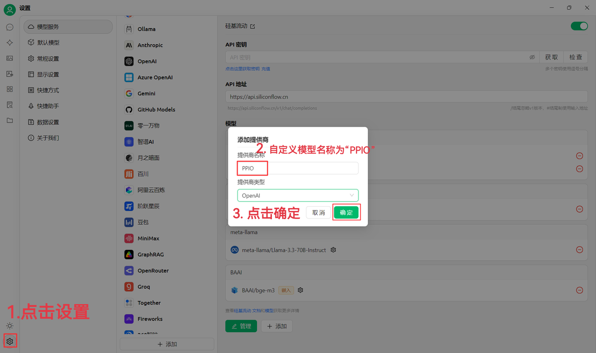
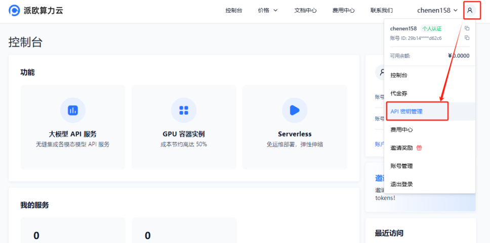
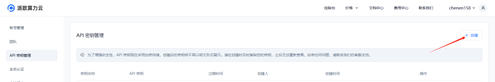
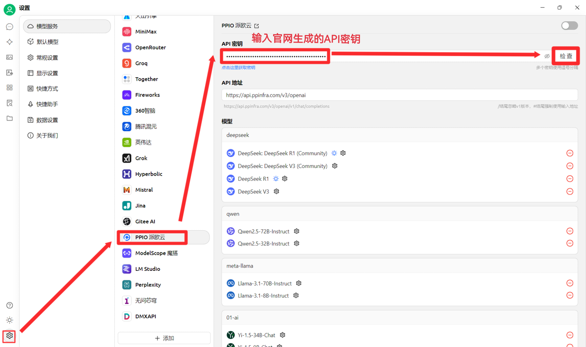
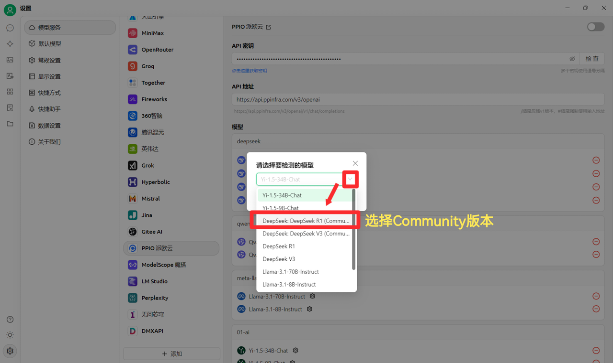
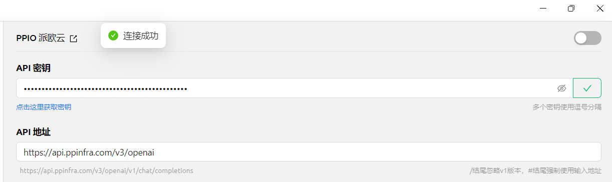
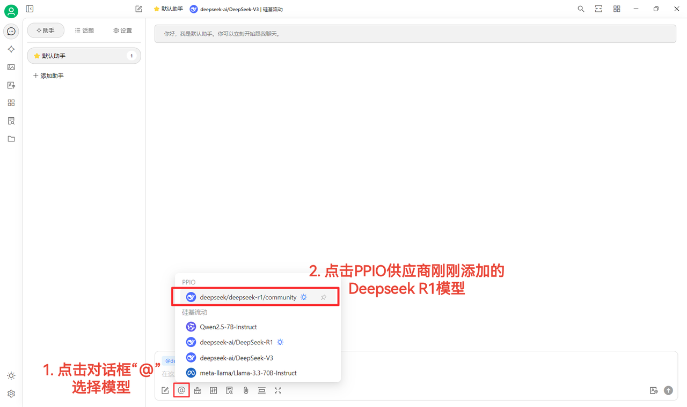

# PPIO 

## SuperAgent  PPIO LLM API

### [​](https://ppinfra.com/docs/third-party/superagent-use#%E6%95%99%E7%A8%8B%E6%A6%82%E8%BF%B0)  

SuperAgent Windows Linux MacOS  LLM 

SuperAgent  **PPIO  API ** —— **DeepSeek-R1/V3 **  **99.9% **

3 SuperAgent  + PPIO  API

### [​](https://ppinfra.com/docs/third-party/superagent-use#1-%E8%BF%9B%E5%85%A5-superagent%EF%BC%8C%E6%B7%BB%E5%8A%A0-%E2%80%9Cppio%E2%80%9D-%E4%BD%9C%E4%B8%BA%E6%A8%A1%E5%9E%8B%E6%8F%90%E4%BE%9B%E5%95%86) 1.  SuperAgent “PPIO”  

 SuperAgent[https://superagent.ng/download](https://superagent.ng/download) [https://pan.quark.cn/s/c8533a1ec63e#/list/share](https://pan.quark.cn/s/c8533a1ec63e#/list/share)

1`PPIO`“”

<figure><figcaption></figcaption></figure>

2 [ API  ](https://ppinfra.com/user/register?invited_by=JYT9GD\&utm_source=github_superagent)—API 

<figure><figcaption></figcaption></figure>

 +  API ****

<figure><figcaption></figcaption></figure>

3 SuperAgent  PPIO  API 

<figure><figcaption></figcaption></figure>

4deepseek/deepseek-r1/community 

<figure><figcaption></figcaption></figure>

DeepSeek R1  V3 community  ** community **

### [​](https://ppinfra.com/docs/third-party/superagent-use#2-%E6%A8%A1%E5%9E%8B%E4%BD%BF%E7%94%A8%E9%85%8D%E7%BD%AE) 2.  

1

<figure><figcaption></figcaption></figure>

2@ PPIO  DeepSeek R1 \~

<figure><figcaption></figcaption></figure>

### [​](https://ppinfra.com/docs/third-party/superagent-use#3-ppio%C3%97superagent-%E8%A7%86%E9%A2%91%E4%BD%BF%E7%94%A8%E6%95%99%E7%A8%8B) 3. PPIO×SuperAgent  

 B PPIO API+SuperAgent → [  DeepSeek +DeepSeek  =](https://www.bilibili.com/video/BV1BZNmeTEwg/?buvid=XX82F37818653072D274A6BB8A4FE7938A30C\&from_spmid=search.search-result.0.0\&is_story_h5=false\&mid=3CpKQv%2Bjnb8k6iTGlUl1eH8FTQ%2FSZMtL1rElX6M3iMo%3D\&plat_id=116\&share_from=ugc\&share_medium=android\&share_plat=android\&share_session_id=b892268f-5751-4f6e-9690-50b37855d346\&share_source=WEIXIN\&share_source=weixin\&share_tag=s_i\&spmid=united.player-video-detail.0.0\&timestamp=1739160448\&unique_k=eKDZuRP\&up_id=3546757841554023\&vd_source=50fea165795ccc47455a165f5bcaeed2)

sola

***

### 

Bug   
