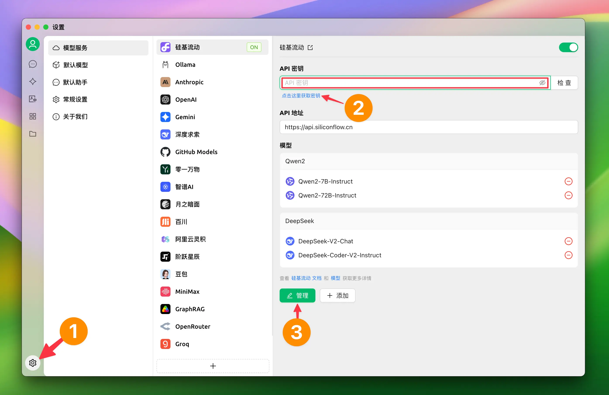
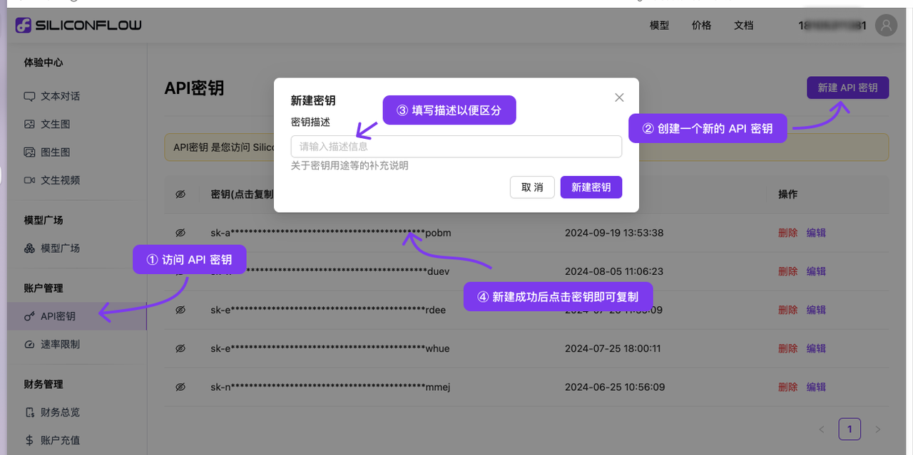
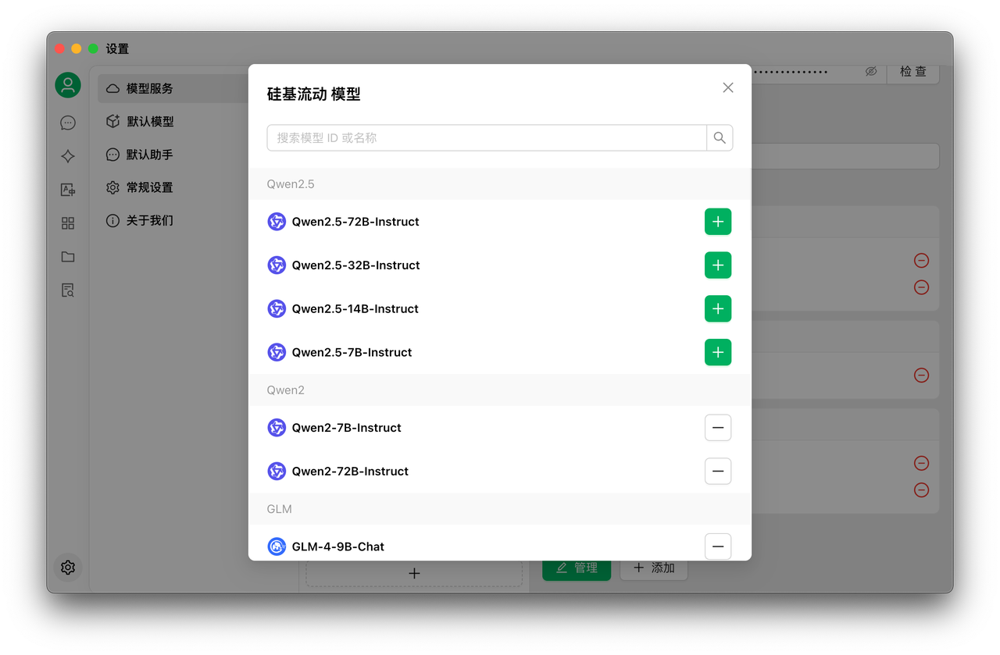
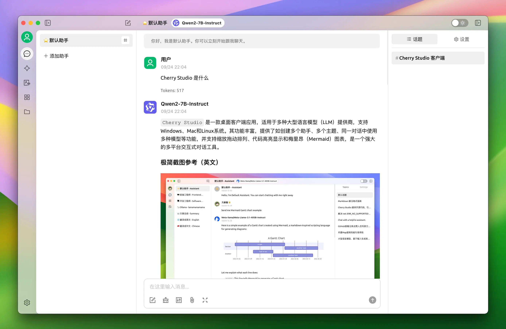

# 

## 1.  SiliconCloud  

#### [​](https://docs.siliconflow.cn/usercases/use-siliconcloud-in-superagent#2-1) 1.2  

<figure><figcaption></figcaption></figure>

#### [​](https://docs.siliconflow.cn/usercases/use-siliconcloud-in-superagent#2-2-siliconcloud-api) 1.2  SiliconCloud API  

1.  [SiliconCloud](https://cloud.siliconflow.cn/)
2.  [API ](https://cloud.siliconflow.cn/account/ak) 

<figure><figcaption></figcaption></figure>

#### [​](https://docs.siliconflow.cn/usercases/use-siliconcloud-in-superagent#2-3) 1.3  

<figure><figcaption></figcaption></figure>

## [​](https://docs.siliconflow.cn/usercases/use-siliconcloud-in-superagent#3) 2.  

1. “”
2. 
3. 

<figure><figcaption></figcaption></figure>

***

### 

Bug   
