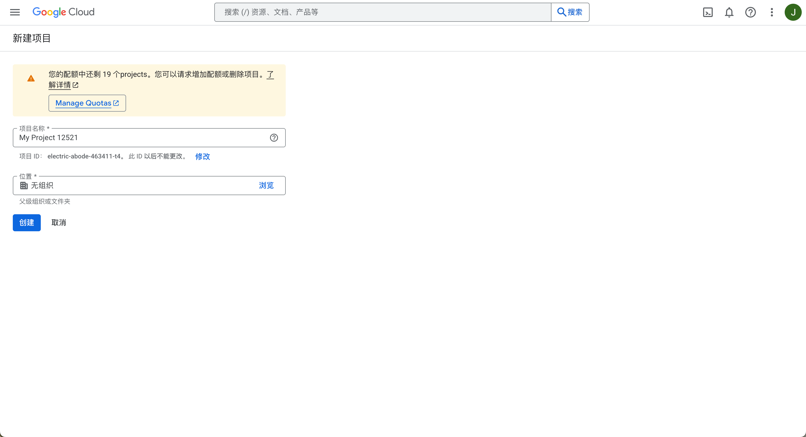
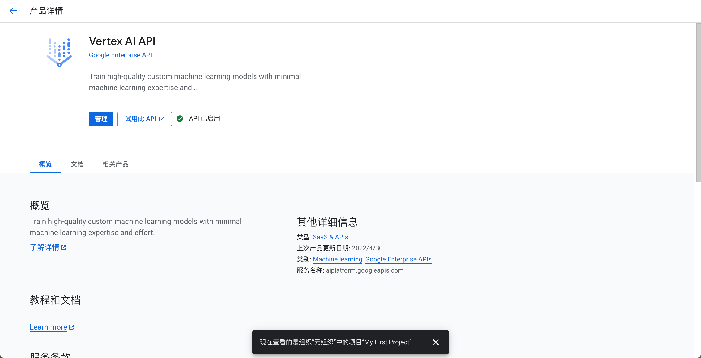
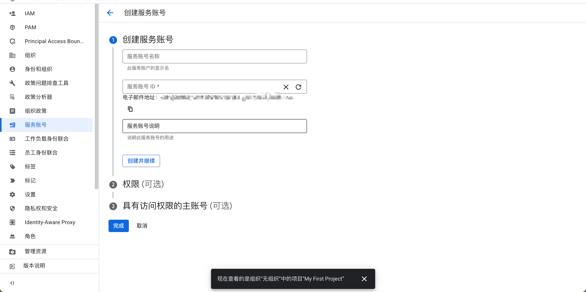
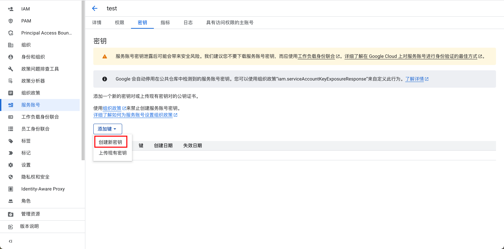
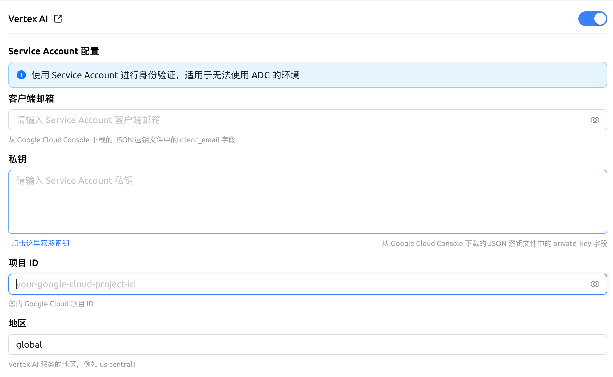

# Vertex AI

## 

### 1.  API Key

*  Gemini  API Key  Google Cloud 
*  [Google Cloud](https://console.cloud.google.com/projectcreate) 

<figure><figcaption></figcaption></figure>

*  [Vertex AI ](https://console.cloud.google.com/vertex-ai)
*  [Vertex AI API](https://console.cloud.google.com/apis/library/aiplatform.googleapis.com?inv=1\&invt=Ab0iBA)

<figure><figcaption></figcaption></figure>

## 2.  API 

*   

<figure><figcaption></figcaption></figure>

*  ``  JSON 

<figure><figcaption></figcaption></figure>

*  JSON  ****

## 3.  SuperAgent  Vertex AI

*  Vertex AI 
*  JSON 

<figure><figcaption></figcaption></figure>

 

***

### 

Bug   
