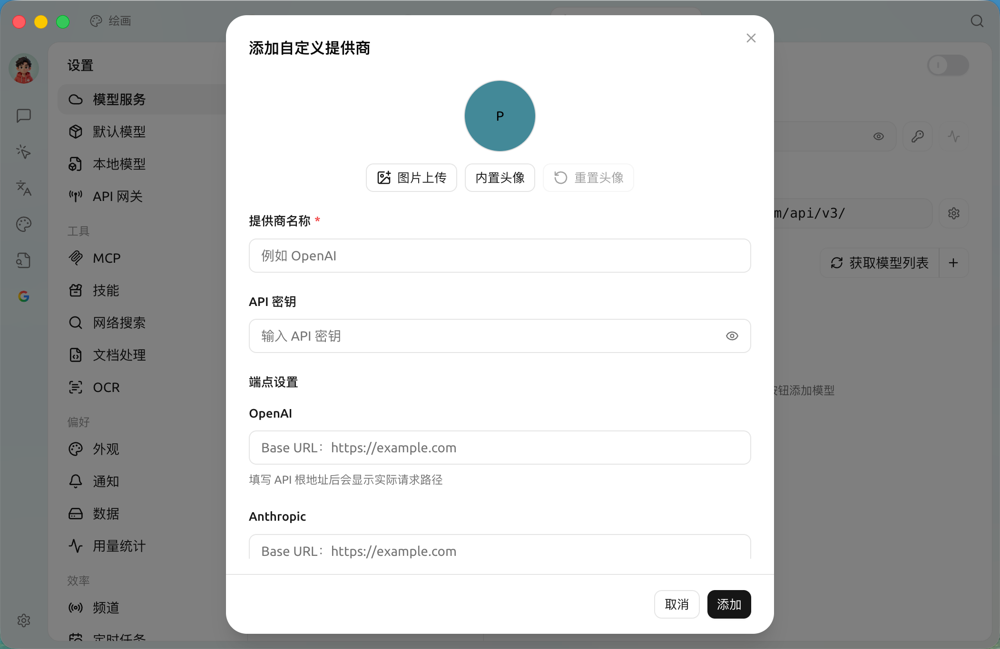
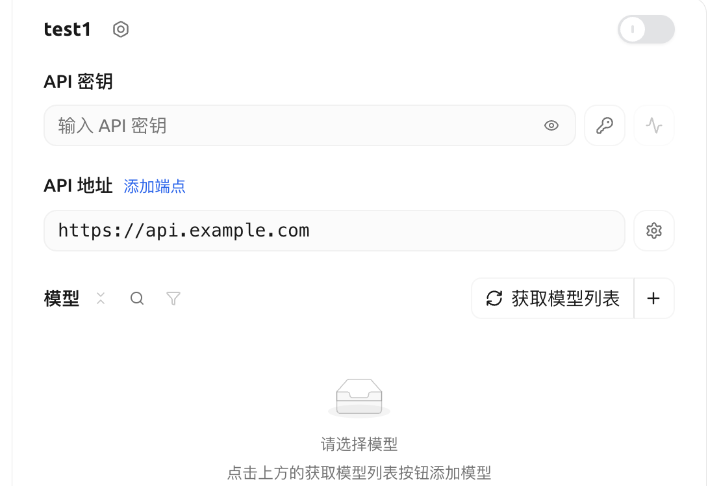
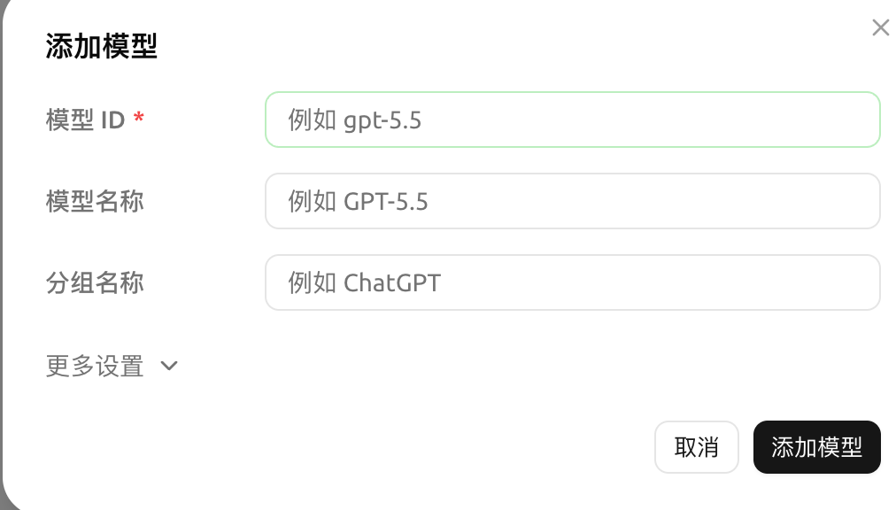

# 

SuperAgent  AI  ** AI **  AI 

##  AI 

* ****  AI 
* ****  AI 
* ****  API 
* **** 

##  AI 

 SuperAgent  AI 

<figure><figcaption></figcaption></figure>

1. ****  SuperAgent “”
2. **** “”
3. **** “”“+ ”“”
4. **** 
   * **** MyCustomOpenAI
   * **API **  API 
   * ****  **OpenAI**  **Anthdropic** “” **OpenAl Responses****Gemini**** Base URL**  ** Base URL**SuperAgent 


 AI  API 



“” Coding Plan   API Key 


6. **** “”

##  AI 

<figure><figcaption></figcaption></figure>


1. **** 
2. ****
    * “” SuperAgent 

    * “+” ID `gpt-5.6-sol``gemini-3.7-flash` 

    <figure><figcaption></figcaption></figure>

    *  AI 
    * “-”

## 

 SuperAgent  AI  AI 

##  vLLM  AI 

vLLM  Ollama  LLM  vLLM  SuperAgent 

1. ** vLLM**  vLLM [https://docs.vllm.ai/en/latest/getting\_started/quickstart.html](https://docs.vllm.ai/en/latest/getting_started/quickstart.html) vLLM

    ```sh
    pip install vllm #  pip
    uv pip install vllm #  uv
    ```
2. ** vLLM **  vLLM  OpenAI 

    *  `vllm.entrypoints.openai.api_server` 

    ```sh
    python -m vllm.entrypoints.openai.api_server --model gpt2
    ```

    *  `uvicorn` 

    ```sh
    vllm --model gpt2 --served-model-name gpt2
    ```

 `8000`    `--port`  vLLM 

3. ** SuperAgent  vLLM **
   *  SuperAgent  AI 
   * **** `vLLM`
   * ****  `OpenAI`
4. ** vLLM **
   * **API **  vLLM  API 
   * **API **  vLLM  API  `http://localhost:8000/`
   * ****  vLLM   `python -m vllm.entrypoints.openai.api_server --model gpt2` ,  `gpt2`
5. ****  SuperAgent  vLLM  `gpt2`  vLLM  LLM 

## 

* ****  AI  API 
* ** API ** “” API 
* ** API **  AI API 
* **:** , .

***

### 

Bug  [](../../question-contact/suggestions.md) 
