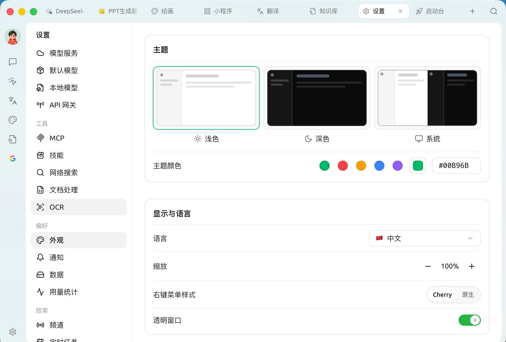
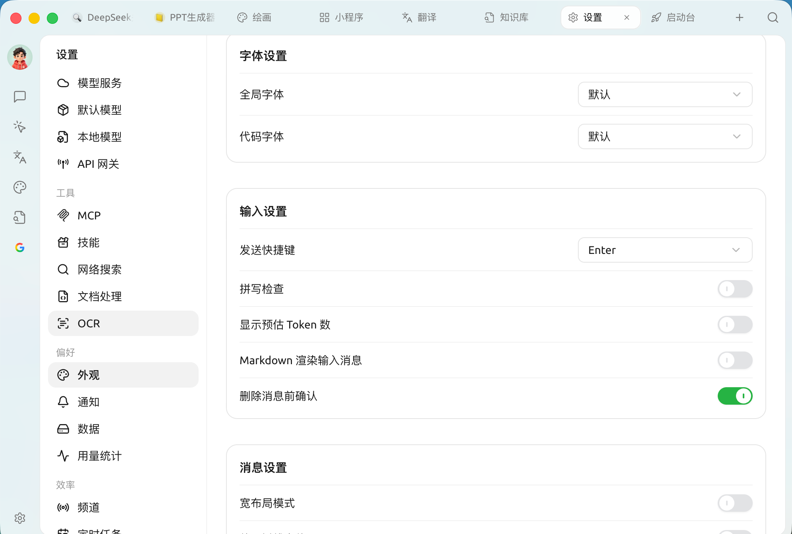
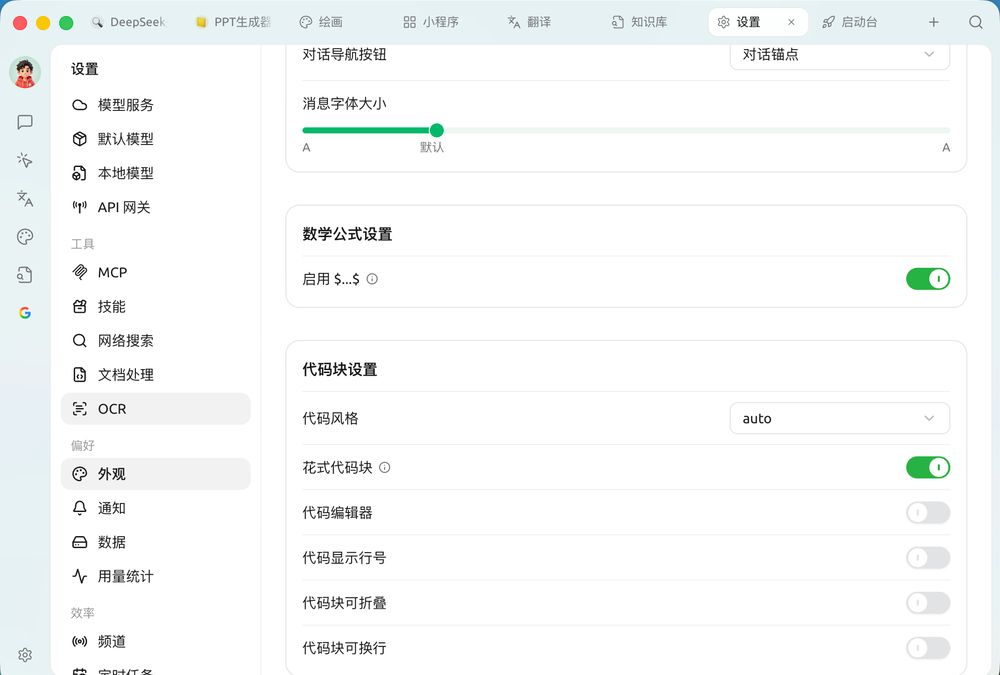

# 

 ****  ` → `

>  [ CSS](../personalization-settings/custom-css.md) 

### 

<figure><figcaption>

</figcaption></figure>

* **** ** /  / ** ""
* **** `#00B96B`

### 

|  |  |
| --- | --- |
| **** |  |
| **** |  /  |
| **** |  Cherry  ****  |
| **** | ** macOS ** |

### 

* ****
* ****

 

### 

<figure><figcaption>

</figcaption></figure>

|  |  |
| --- | --- |
| **** |  `Enter``Shift+Enter`  |
| **** |  |
| ** Token ** |  Token |
| **Markdown ** |  Markdown  |
| **** |  |

### 

 AI 

|  |  |
| --- | --- |
| **** |  |
| **** |  |
| **** |  |
| **** |  |
| **** |  ****  ****  |
| **** |  **** |
| **** |  **** |
| **** |  |

### 

* ** `$...$`** `$` 

### 

<figure><figcaption>

</figcaption></figure>

|  |  |
| --- | --- |
| **** |  `auto`  |
| **** |  |
| **** |  |
| **** |  |
| **** |  |
| **** |  |

>  ****  ** /  /  / ** 

### 

* ****
* **** mermaid 





###  CSS

 CSS [ CSS](../personalization-settings/custom-css.md) [ CSS ](../personalization-settings/clear-css.md)

***

### 

Bug   
