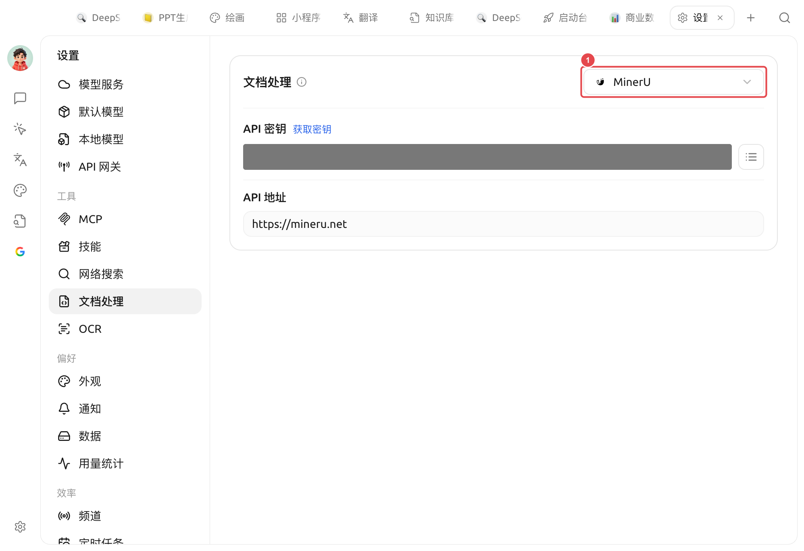

# 

** SuperAgent "PDF / "**

 PDF  


** vs OCR**

* **** **PDF / ** 
* **[OCR](ocr.md)** ** / ** 

 PDF`.md`/`.txt`/`.docx` 


### 

 →****

<figure><figcaption>
①  MinerU API  API 
</figcaption></figure>

### 

 6  **MinerU**

|  |  |  |
| --- | --- | --- |
| **** |  |  |
| **MinerU** | OpenDataLab  PDF  | API [mineru.net/apiManage](https://mineru.net/apiManage)|
| **PaddleOCR** |  OCR  |  API  API  |
| **Doc2x** |  | API [open.noedgeai.com](https://open.noedgeai.com/apiKeys)|
| **Mistral** |  | API [mistral.ai](https://mistral.ai/api-keys)|
| **Open MinerU** |  MinerU  |  API  API |

###  MinerU



###  API 

API  MinerU  key



###  API 

API 



###  / 

 PDF 




****API /API  **PaddleOCR**  **Open MinerU** ——API 


### 

* " → "
*   
* "" 

### 

* MinerU  /  PDF 
*  **** PDF  [OCR](ocr.md)

***

### 

Bug   
