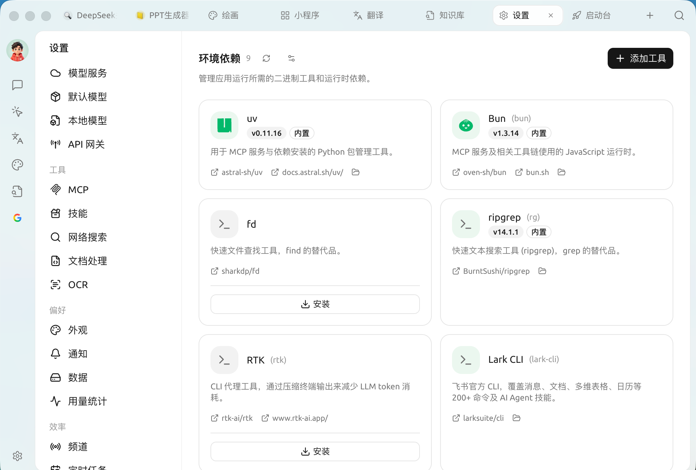

# 

 ** SuperAgent ** [MCP ](../../advanced-basic/extensions/mcp/)  `uv``bun` SuperAgent 

 ` → `

<figure><figcaption>

</figcaption></figure>

### 

*  <mark style="color:blue;">****</mark>  SuperAgent 
*  ****  SuperAgent 
* 

|  |  |
| --- | --- |
| **uv** |  MCP  Python  |
| **Bun** | MCP  JavaScript  |
| **fd** | `find`  |
| **ripgrep (rg)** | `grep`  |
| **RTK** |  LLM token  CLI  |
| **Lark CLI** |  CLI /  /  /  200+  |

 `gh`GitHub CLI`ntn`Notion CLI`pi`  CLI  Claude Code / Codex   

### 

**** mise  `github:sharkdp/fd``uv``bun`

### 

****

* **GitHub ** GitHub Release  `https://ghfast.top`
* **GitHub ** GitHub API 
* **npm  / pip ** `npm:` / `pipx:` 
* **** Sigstore / SLSA 


—— MCP ""



 MCP " uv / bun / """ ****


***

### 

Bug   
