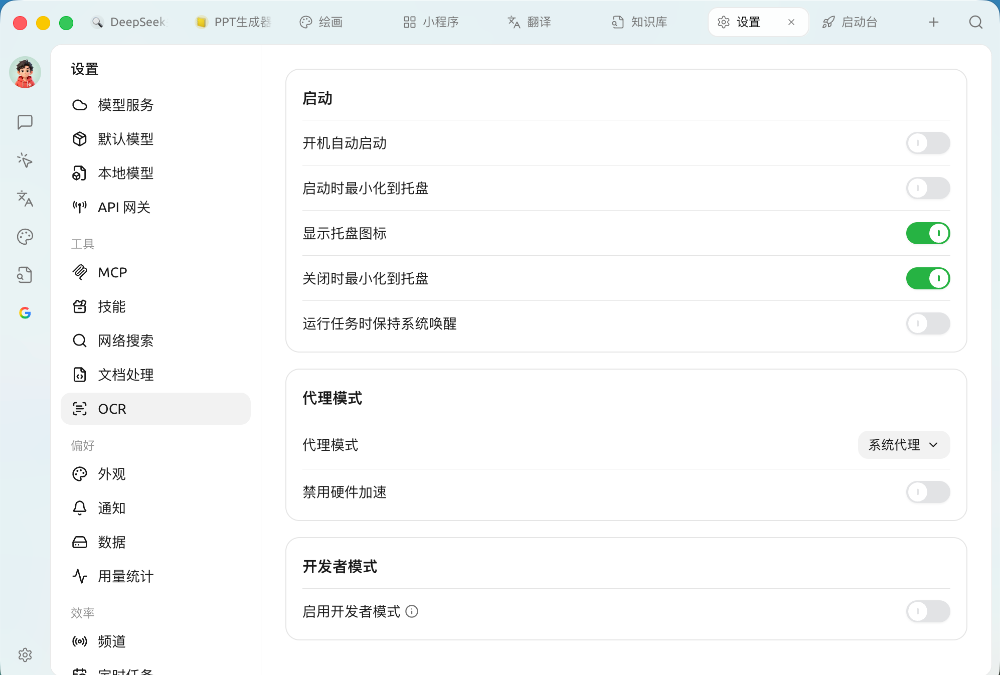

# 

 SuperAgent **** ` → `

<figure><figcaption>

</figcaption></figure>

### 

 SuperAgent 

|  |  |  |
| --- | --- | --- |
| **** |  SuperAgent |  |
| **** |  | "" |
| **** |  |  |
| **** |  `X`  | "" |
| **** |  |  |


 ****  `X` 


### 

SuperAgent  API

|  |  |
| --- | --- |
| **** |  /  |
| **** |  `http://127.0.0.1:7890` ****—— `localhost,127.0.0.1,::1` `*.test.com``192.168.0.0/16`  |
| **** |  |

* **** ****  CPU 


"""API " ****——


### 

* **** ****  **** 


    


***

### 

Bug   
