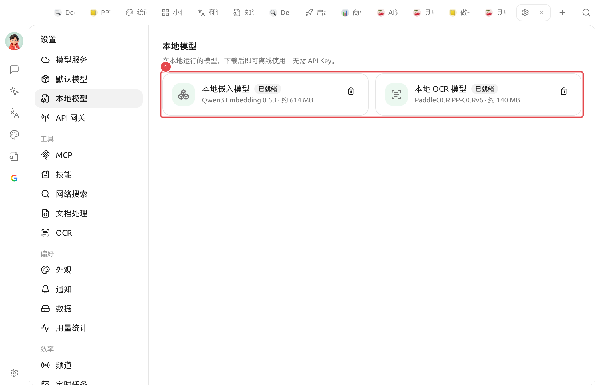

# 

 SuperAgent ****  API API Key""

 ` → ` 

<figure><figcaption>
① —— +  OCR 
</figcaption></figure>

|  |  |  |  |
| ------------- | -------------------- | -------- | --------------------------------------------------------------- |
| **** | Qwen3 Embedding 0.6B |  614 MB |    |
| ** OCR ** | PaddleOCR PP-OCRv6 |  140 MB |  /  [OCR](ocr.md)  |

### 

*  **** **** ****
*  **** 
*  / ****

SuperAgent 






 ****   OCR 


### 

* ** / **
* ** OCR** OCR  [OCR ](ocr.md)  PaddleOCR
* ****


""  OCR 


***

### 

Bug   
