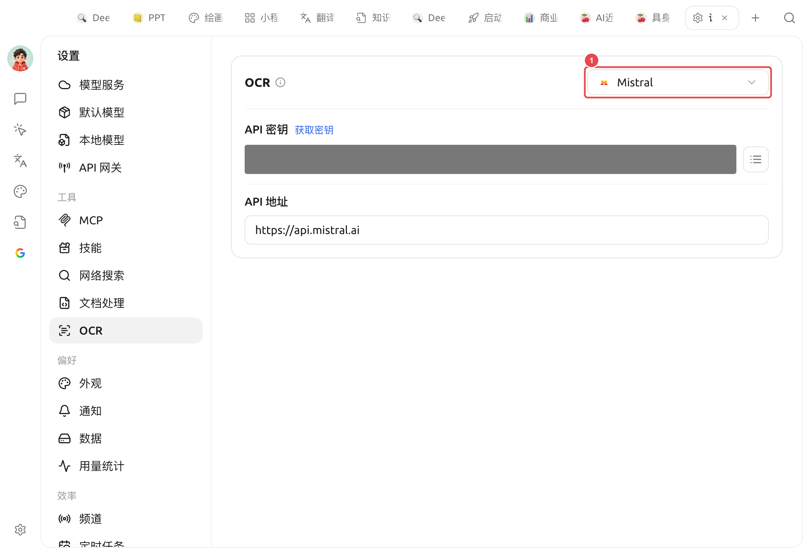

# OCR

OCROptical Character Recognition ** AI **

*  /  AI 
*  
*  

OCR  →OCR 

<figure><figcaption>
OCR ①  Mistral API  API 
</figcaption></figure>

### 

 OCR ****

|  |  /  |  |
| --- | --- | --- |
| **System OCR** |  | macOS Live Text / Windows OCR |
| **PaddleOCR** |  API  API  |  Paddle  |
| ** PaddleOCR** | → OCR  140MB|  |
| **Tesseract OCR** |  |  OCR |
| **Mistral** | Mistral API  |  /  |
| **Intel OV OCR** | Intel OpenVINONPU | ** Windows + Intel  Ultra NPU OV ** |


 **System OCR**——  PaddleOCR  Mistral


 System OCR  <mark style="color:green;"> macOS Live Text / Windows OCR </mark>


*  PaddleOCR→ OCR 
* **Tesseract** Windows  System OCR


### 

 OCR   

* **OCR** ** / **  → 
* **** **PDF / **  PDF → 

 PDF`.md`/`.txt`/`.docx` 

***

### 

Bug   
