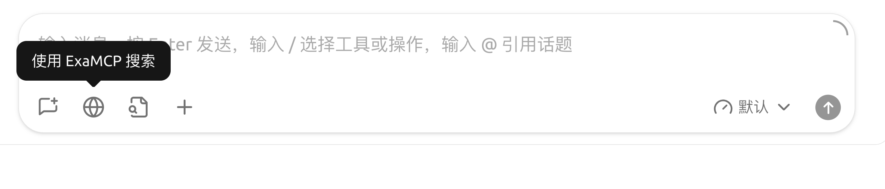
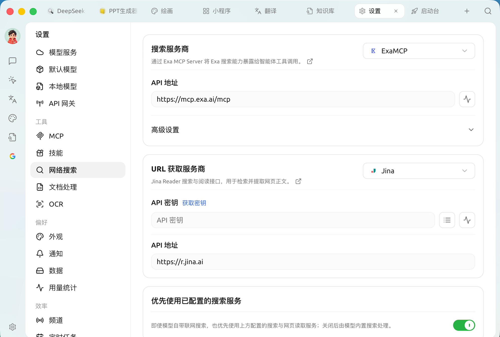
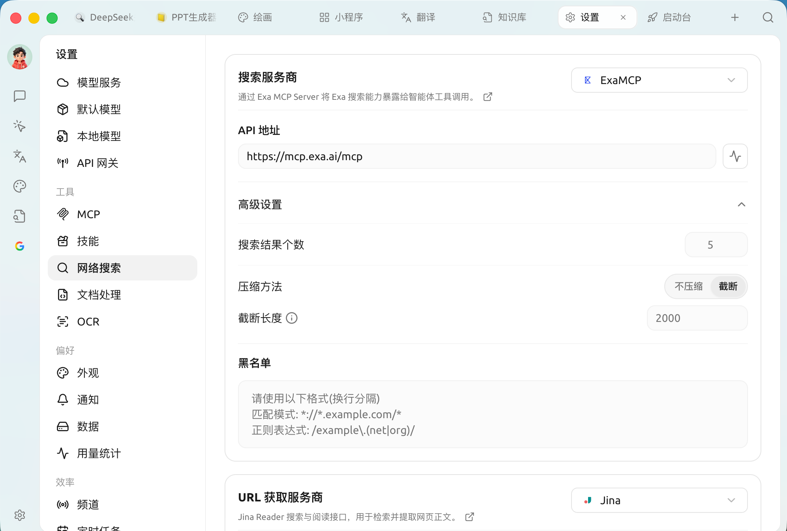

# 


 AI 

* **** /  / 
* ****
* ****


## 

 🌐 **** 

<figure><figcaption>

</figcaption></figure>

****SuperAgent  **Exa MCP** ** API ** MCP  `mcp.exa.ai` URL  **Jina** 🌐 

## 

 ` → ` **** ****

* **** 🌐  ` → ` —— Exa MCP
* **** **** 🌐


**🌐**

**Agent **Claude Codepipi durable**** ` → `  URL 

 Agent pipi durable API  Claude Code Web  Claude Code  WebSearch / WebFetch 


 🌐 

* **DeepSeek**
* **OpenRouter** URL 
* **** Qwen  URL 
* Google Gemini AIxAI Grok 

 🌐 


  


## 

 ` → `****

|  |  |
| ------------- | --------------------- |
| **** |  |
| **URL ** |  |

<figure><figcaption>
 / URL  
</figcaption></figure>

### 

 **API**  **MCP** 

|  |  |  |  |
| ------------- | --- | ----------- | ------------------------------- |
| **Exa MCP** | MCP |  | **** |
| **Tavily** | API |  |  LLM  |
| **Bocha** | API |  |  AI  API +  |
| **Exa** | API |  |  AI  |
| **Zhipu** | API |  |  GLM Web Search |
| **Querit** | API |  |  AI  |
| **SearXNG** | API |  |  |
| **Firecrawl** | API |  |  Markdown |
| **Jina** | API |  · URL  | Jina Reader ** URL ** |
| **Fetch** | API | URL  |  URL  |

>  **Exa MCP** API  API **SearXNG** **Fetch** 

### 

* **** 5 100 Token
* **** Token 2000 
* **** 

<figure><figcaption>
 / 
</figcaption></figure>

## 

 Exa MCP 

*  —— 
* [Tavily ](tavily.md) ——  Tavily 
* [SearXNG ](searxng.md) —— 
*  —— 

## 

1. “”
2. SuperAgent 
3. 
4. SuperAgent  AI 
5. AI 

***

### 

Bug   
