# SearXNG 

SuperAgent  SearXNG SearXNG  API 

**SearXNG **[SearXNG](https://github.com/searxng/searxng)

## SearXNG 

*  API
* 
* 

## 

### Docker 

 SearXNG  docker compose Docker 

#### 1.  [docker](https://www.docker.com/)

<figure>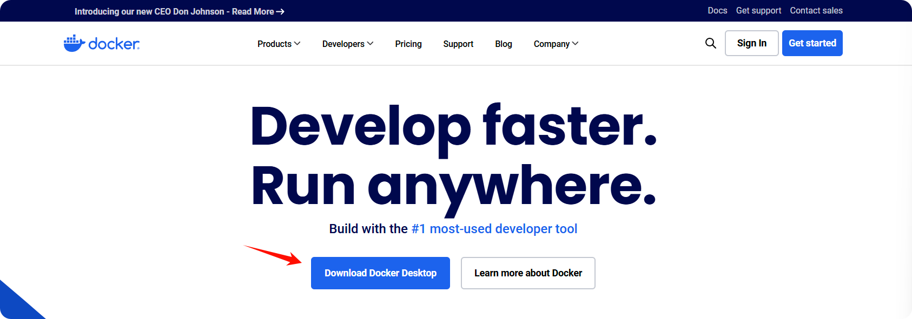<figcaption></figcaption></figure>


<figure>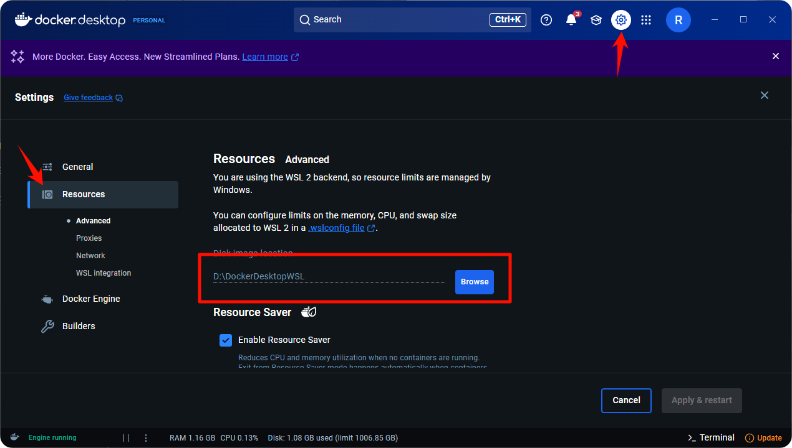<figcaption></figcaption></figure>

#### 2.  SearXNG 

 **searxng** 

<figure>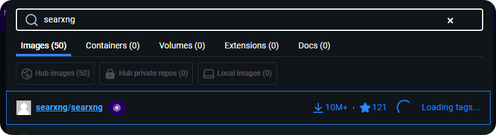<figcaption></figcaption></figure>


<figure>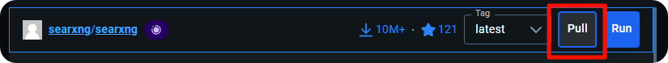<figcaption></figcaption></figure>

<figure>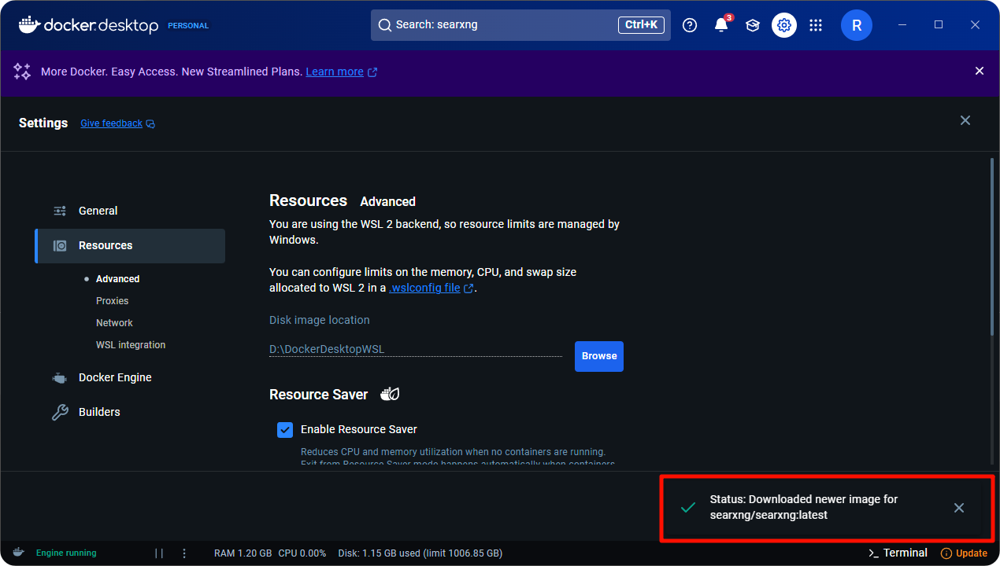<figcaption></figcaption></figure>

#### 3. 

 **images** 

<figure>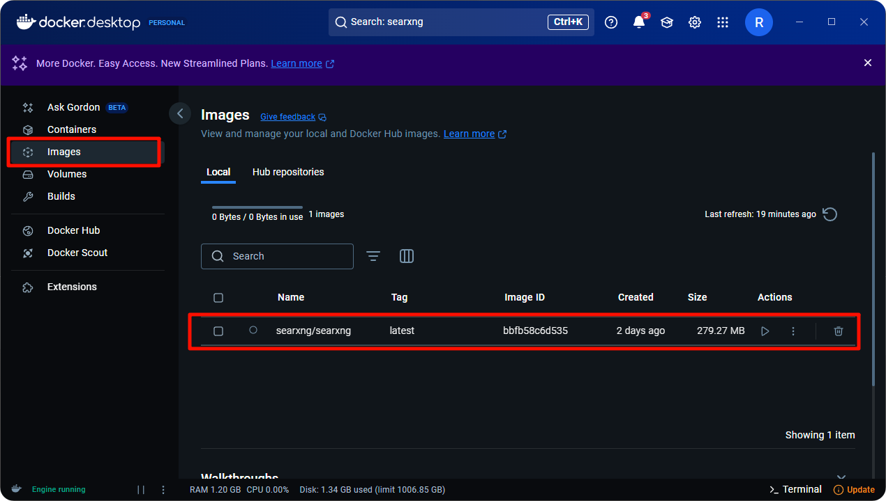<figcaption></figcaption></figure>


<figure>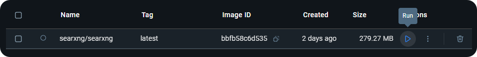<figcaption></figcaption></figure>


<figure>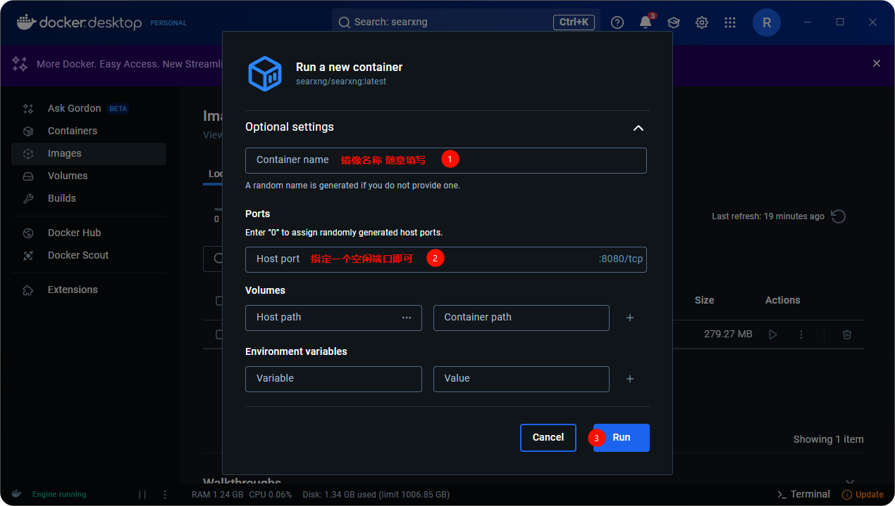<figcaption></figcaption></figure>

 `8085` 

<figure>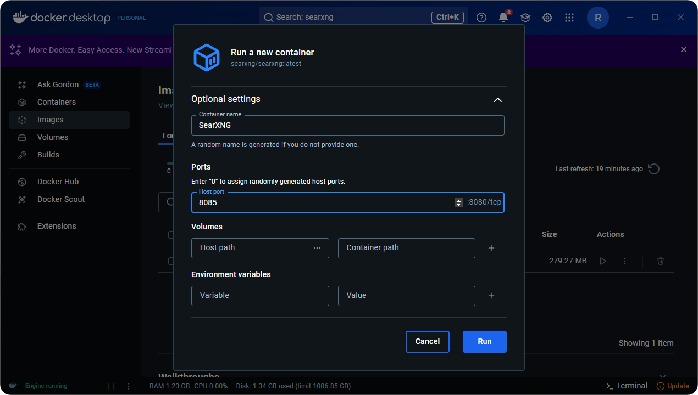<figcaption></figcaption></figure>

 SearXNG 

<figure>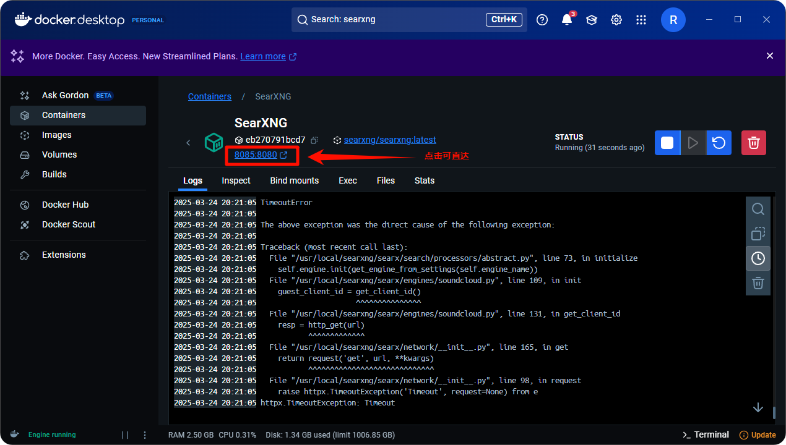<figcaption></figcaption></figure>


<figure>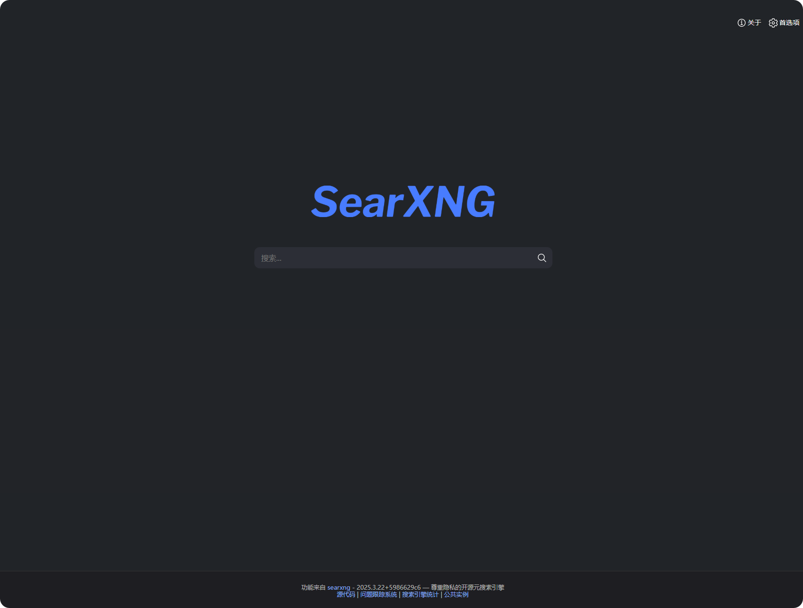<figcaption></figcaption></figure>

## 

 Windows  Docker  SearXNG SearXNG 

SuperAgent  [HTTP RFC7617](https://developer.mozilla.org/zh-CN/docs/Web/HTTP/Guides/Authentication) SearXNG  ****  Nginx  HTTP  Linux 

###  SearXNG

 Docker  [](https://docs.docker.com/engine/install)  Docker CE Debian 

```bash
sudo apt update
sudo apt install git -y

# 
cd /opt
git clone https://github.com/searxng/searxng-docker.git
cd /opt/searxng-docker

# ,  false
export IMAGE_PROXY=true

# 
cat <<EOF > /opt/searxng-docker/searxng/settings.yml
# see https://docs.searxng.org/admin/settings/settings.html#settings-use-default-settings
use_default_settings: true
server:
  # base_url is defined in the SEARXNG_BASE_URL environment variable, see .env and docker-compose.yml
  secret_key: $(openssl rand -hex 32)
  limiter: false # can be disabled for a private instance
  image_proxy: $IMAGE_PROXY
ui:
  static_use_hash: true
redis:
  url: redis://redis:6379/0
search:
  formats:
    - html
    - json
EOF
```

 nginx `docker-compose.yaml` 

```yaml
version: "3.7"

services:
#  Caddy  Nginx, .  Caddy.
  caddy:
    container_name: caddy
    image: docker.io/library/caddy:2-alpine
    network_mode: host
    restart: unless-stopped
    volumes:
      - ./Caddyfile:/etc/caddy/Caddyfile:ro
      - caddy-data:/data:rw
      - caddy-config:/config:rw
    environment:
      - SEARXNG_HOSTNAME=${SEARXNG_HOSTNAME:-http://localhost}
      - SEARXNG_TLS=${LETSENCRYPT_EMAIL:-internal}
    cap_drop:
      - ALL
    cap_add:
      - NET_BIND_SERVICE
    logging:
      driver: "json-file"
      options:
        max-size: "1m"
        max-file: "1"
#  Caddy  Nginx, .  Caddy.
  redis:
    container_name: redis
    image: docker.io/valkey/valkey:8-alpine
    command: valkey-server --save 30 1 --loglevel warning
    restart: unless-stopped
    networks:
      - searxng
    volumes:
      - valkey-data2:/data
    cap_drop:
      - ALL
    cap_add:
      - SETGID
      - SETUID
      - DAC_OVERRIDE
    logging:
      driver: "json-file"
      options:
        max-size: "1m"
        max-file: "1"

  searxng:
    container_name: searxng
    image: docker.io/searxng/searxng:latest
    restart: unless-stopped
    networks:
      - searxng
    #  8080 ,  8000  "127.0.0.1:8000:8080"
    ports:
      - "127.0.0.1:8080:8080"
    volumes:
      - ./searxng:/etc/searxng:rw
    environment:
      - SEARXNG_BASE_URL=https://${SEARXNG_HOSTNAME:-localhost}/
      - UWSGI_WORKERS=${SEARXNG_UWSGI_WORKERS:-4}
      - UWSGI_THREADS=${SEARXNG_UWSGI_THREADS:-4}
    cap_drop:
      - ALL
    cap_add:
      - CHOWN
      - SETGID
      - SETUID
    logging:
      driver: "json-file"
      options:
        max-size: "1m"
        max-file: "1"

networks:
  searxng:

volumes:
#  Caddy  Nginx, 
  caddy-data:
  caddy-config:
#  Caddy  Nginx, 
  valkey-data2:
```

 `docker compose up -d`  `docker compose logs -f searxng` 

###  Nginx  HTTP 

 1Panel nginx  nginx \


```conf
server
{
    listen 443 ssl;

    # 
    server_name search.example.com;

    # index index.html;
    # root /data/www/default;

    #  SSL 
    ssl_certificate /path/to/your/cert/fullchain.pem;
    ssl_certificate_key /path/to/your/cert/privkey.pem;

    # HSTS
    # add_header Strict-Transport-Security "max-age=31536000; includeSubDomains; preload";

    # ,  location 
    location / {
        #  location , .
        #  /etc/nginx/conf.d/ .
        #  /www , .
        auth_basic "Please enter your username and password";
        auth_basic_user_file /etc/nginx/conf.d/search.htpasswd;

        proxy_http_version 1.1;
        proxy_set_header Connection "";
        proxy_redirect off;
        proxy_set_header Host $host;
        proxy_set_header X-Forwarded-For $proxy_protocol_addr;
        proxy_pass http://127.0.0.1:8000;
        client_max_body_size 0;
    }

    # access_log ...;
    # error_log ...;
}
```

 Nginx  `/etc/nginx/conf.d` 

 `example_name``example_password` 

```bash
echo "example_name:$(openssl passwd -5 'example_password')" > /etc/nginx/conf.d/search.htpasswd
```

 Nginx

 SearXNG 

<figure>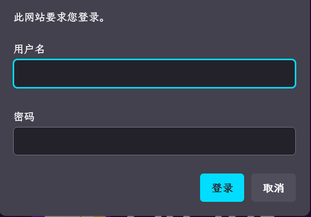<figcaption></figcaption></figure>

## SuperAgent 

SearXNG  SuperAgent 

 Searxng 

<figure>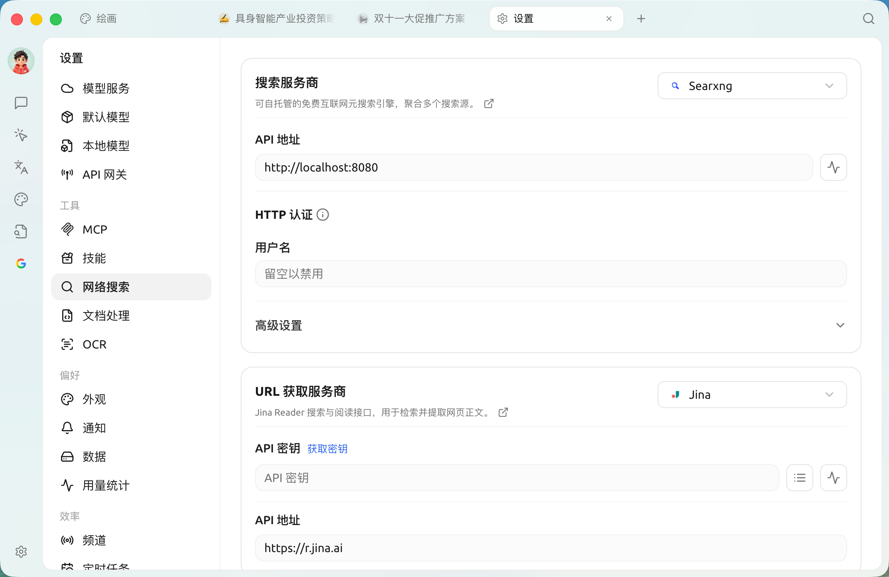<figcaption></figcaption></figure>


<figure>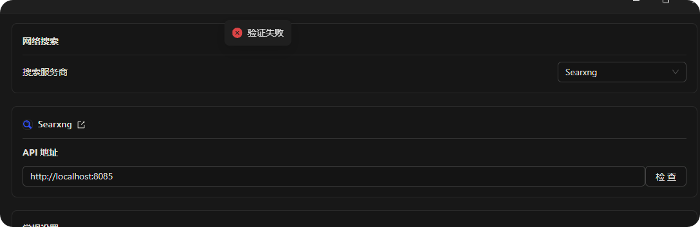<figcaption></figcaption></figure>

 json 

 Docker Files 

<figure>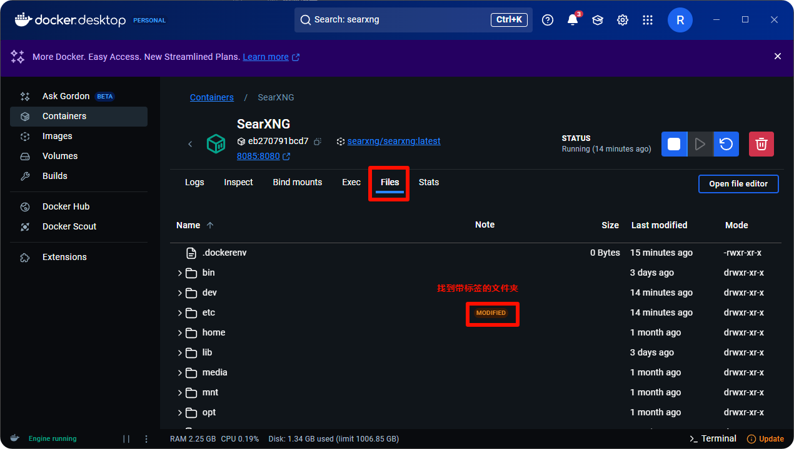<figcaption></figcaption></figure>


<figure>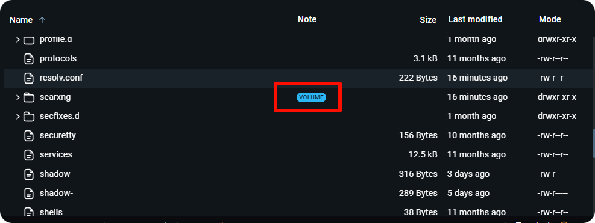<figcaption></figcaption></figure>

 **settings.yml** 

<figure>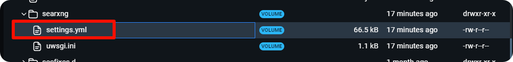<figcaption></figcaption></figure>


<figure>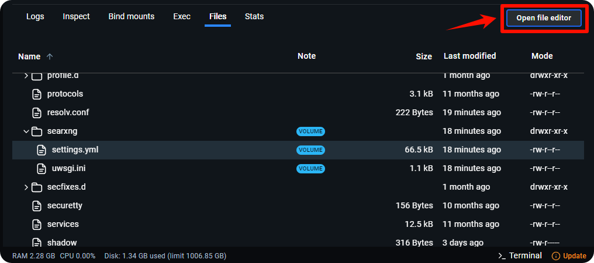<figcaption></figcaption></figure>

 78  html

<figure>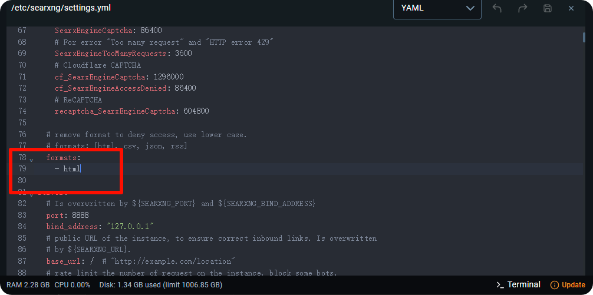<figcaption></figcaption></figure>

 json 

<figure>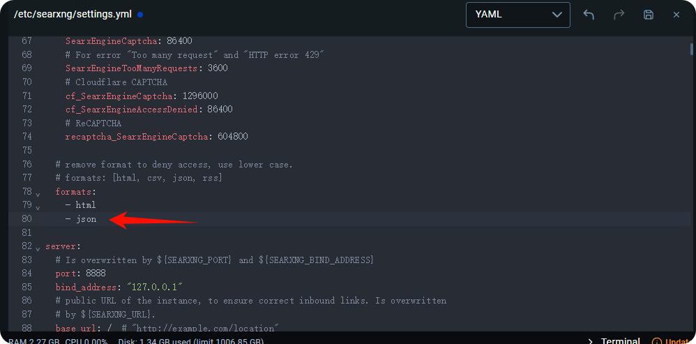<figcaption></figcaption></figure>

<figure>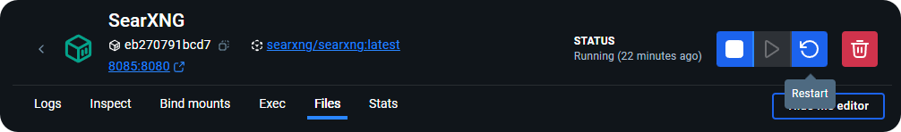<figcaption></figcaption></figure>

 SuperAgent 

<figure>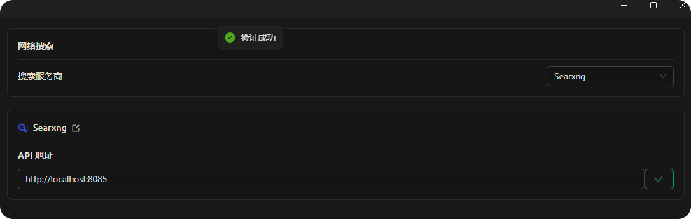<figcaption></figcaption></figure>

 [http://localhost](http://localhost) : \
 docker [http://host.docker.internal](http://host.docker.internal) : 

 json  HTTP  401 

<figure>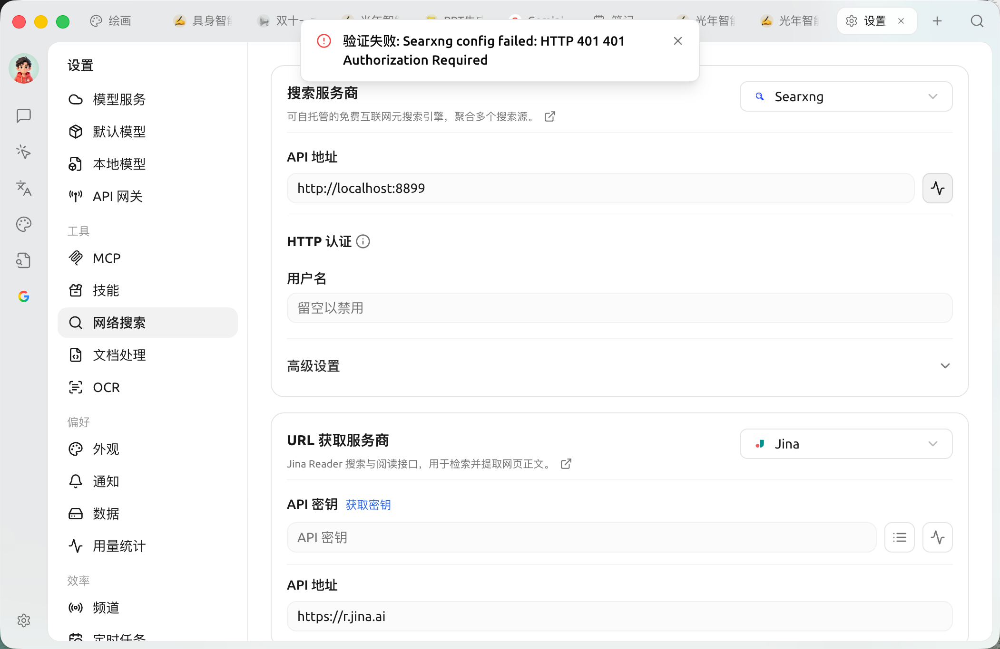<figcaption></figcaption></figure>

 HTTP 

<figure>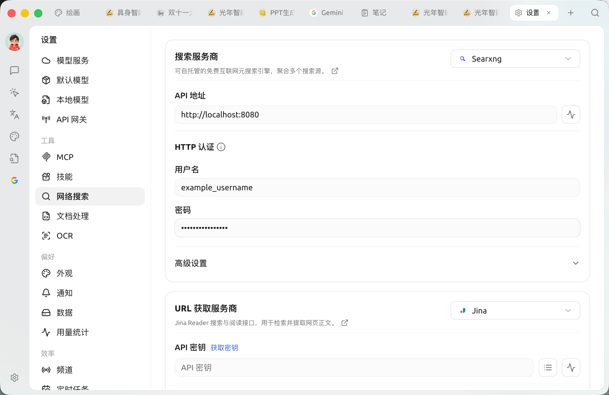<figcaption></figcaption></figure>


### 

 SearXNG 


<figure>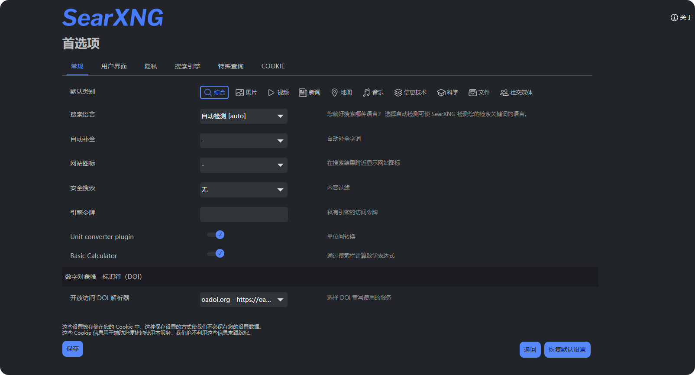<figcaption></figcaption></figure>


<figure>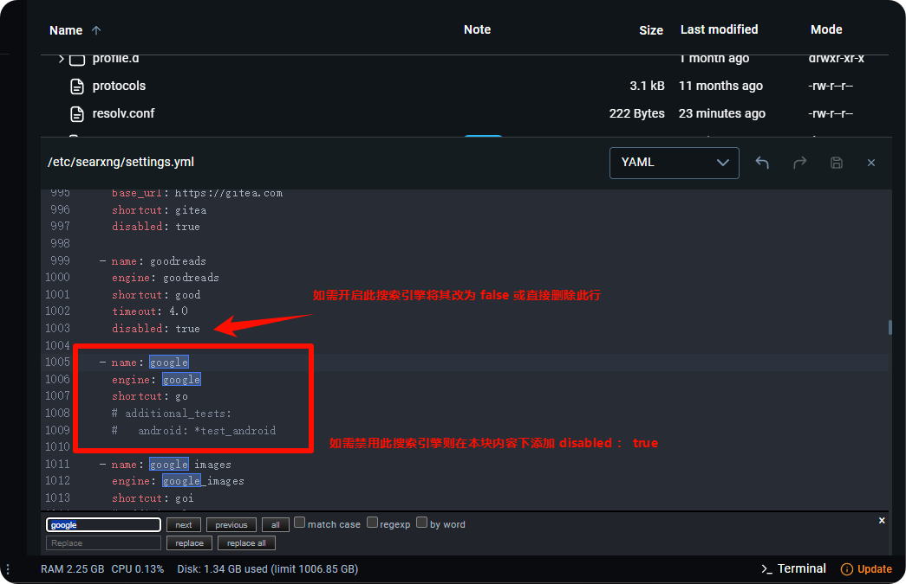<figcaption></figcaption></figure>

<figure>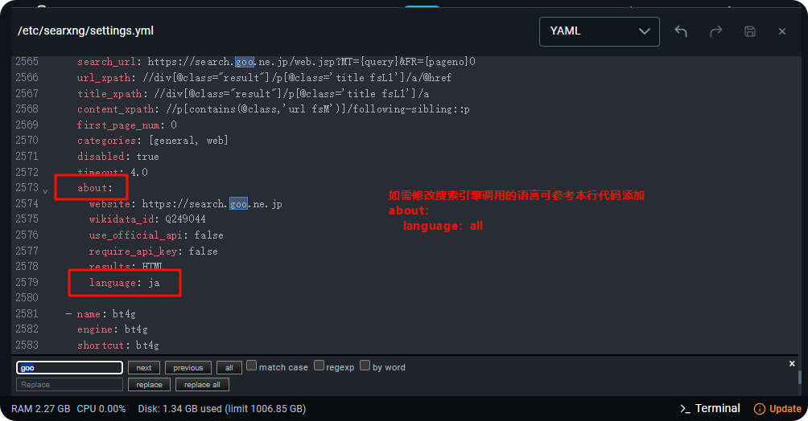<figcaption></figcaption></figure>


<figure>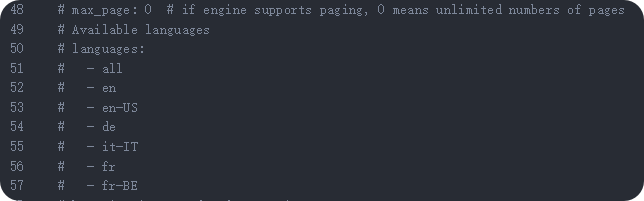<figcaption></figcaption></figure>

 IDE 

## 

###  json 

 json

<figure>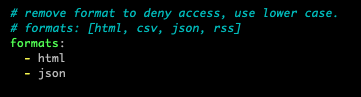<figcaption></figcaption></figure>

### 

SuperAgent  categories  web general  google  google  searxng  baidu 

```
use_default_settings:
  engines:
    keep_only:
      - baidu
engines:
  - name: baidu
    engine: baidu 
    categories: 
      - web
      - general
    disabled: false
```

### 

searxng  limiter  API  false

<figure>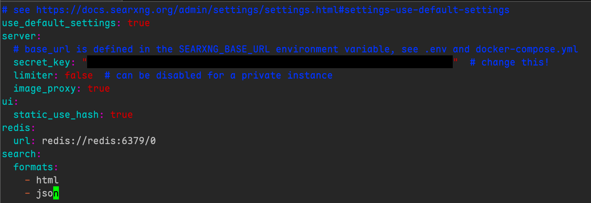<figcaption></figcaption></figure>

***

### 

Bug  [](../../question-contact/suggestions.md) 
