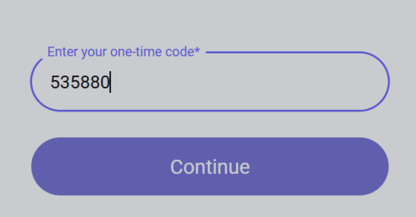
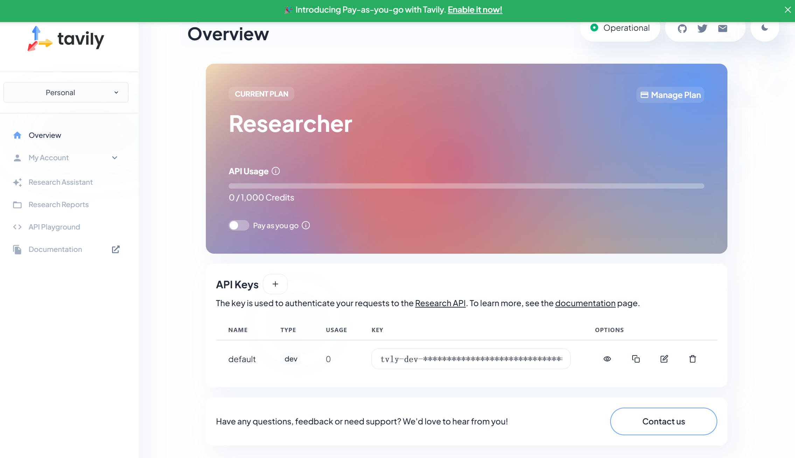

# Tavily 

### tavily 

[https://app.tavily.com/home](https://app.tavily.com/home)





### tavily 

 cherry studio -  -  -  tavily 


Sign upLog in


1. github 

<figure><figcaption>

</figcaption></figure>

2. 🚨🚨🚨<mark style="color:red;">****</mark><mark style="color:green;background-color:red;">****</mark><mark style="color:red;">** **</mark><mark style="color:green;">****</mark><mark style="color:red;">** Code **</mark>

<figure><figcaption>
....
</figcaption></figure>


 2 

1.  APP—— Authenticator 
2.  


3. 

<figure><figcaption>
--
</figcaption></figure>

<figure><figcaption>
 tavily 
</figcaption></figure>

<figure><figcaption>

</figcaption></figure>

<figure><figcaption>
 tavily 
</figcaption></figure>

<figure><figcaption>
 code 
</figcaption></figure>

### 

 key  cherry studio 

<figure><figcaption></figcaption></figure>

***

### 

Bug   
